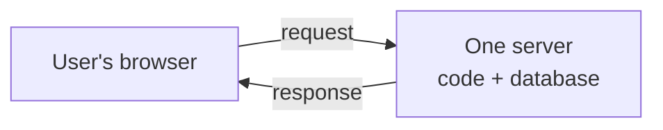
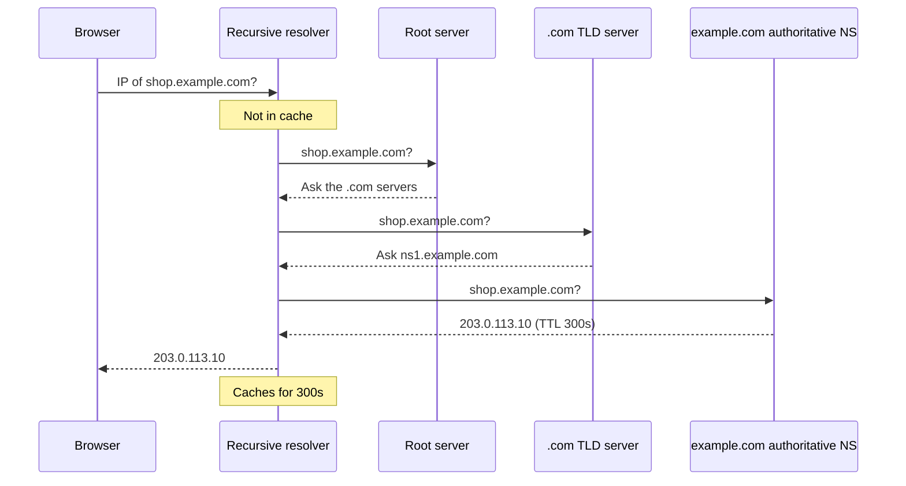
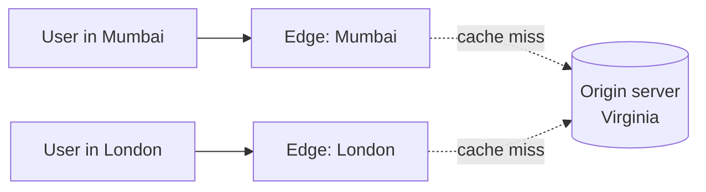
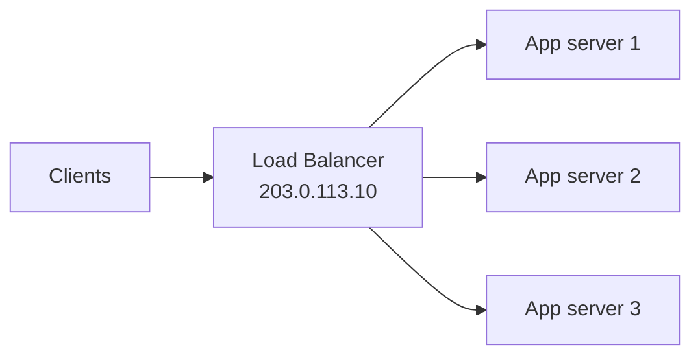
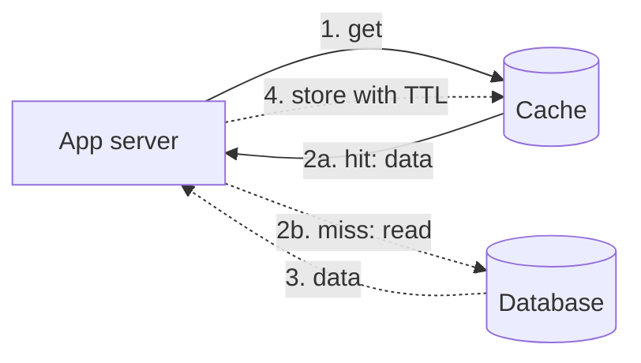
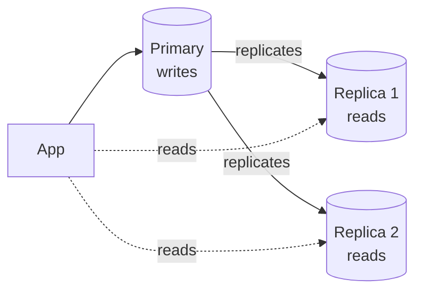
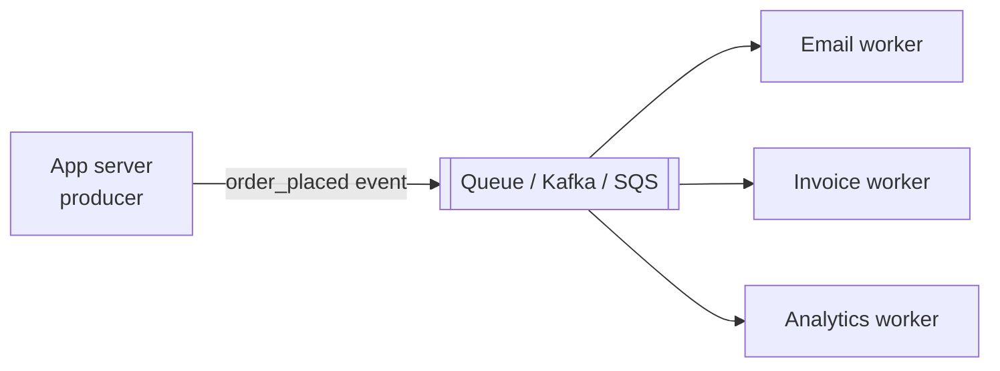
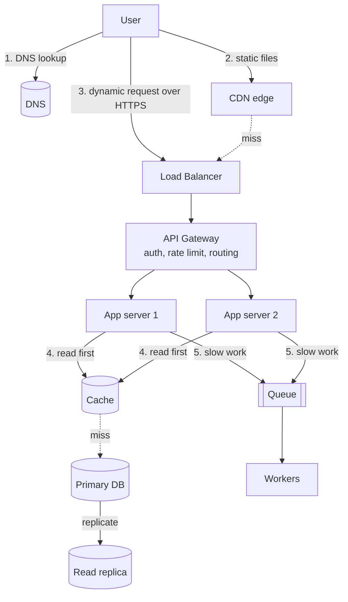

# 1.1 Life of a Request

Goal: understand **what each component is, why it exists, and how it works**, so that when you draw `Client → DNS → CDN → Load Balancer → App Server → Cache → Database` you can explain every box.

We build the system the way it really evolves: start with one server, hit a problem, add one component to fix it. Every component below exists because of a specific problem.

---

## 0. Start simple: one server

You build a website, `shop.example.com`. You rent one computer (a **server**) that is always on and connected to the internet. It runs your code and holds your data.



- **Client**: whoever asks (browser, mobile app, another service).
- **Server**: a computer that listens for requests and answers them.
- **Request / response**: client sends "give me product 42"; server replies with the data. This is the **HTTP** protocol (HyperText Transfer Protocol), the common language for web requests.

A request looks roughly like this:

```
GET /products/42 HTTP/1.1
Host: shop.example.com
Authorization: Bearer <token>
```

and the response:

```
HTTP/1.1 200 OK
Content-Type: application/json

{ "id": 42, "name": "Keyboard", "price": 49.99 }
```

- **Method**: `GET` (read), `POST` (create), `PUT/PATCH` (update), `DELETE`.
- **Status code**: `2xx` success, `3xx` redirect, `4xx` client error (404 not found, 401 not logged in), `5xx` server error (500, 503).

Problems appear as soon as you grow. Each section below solves one.

---

## 1. Problem: "How does the browser find my server?" → DNS

### The problem
Computers on the internet talk using **IP addresses** (e.g. `203.0.113.10`). Humans remember names (`shop.example.com`). Something has to translate names into IP addresses.

### What is DNS?
**DNS (Domain Name System)** is the internet's phone book. You give it a name, it gives you an IP address.

```
shop.example.com  →  203.0.113.10
```

It is not one giant database. It is a **hierarchy** of servers, each responsible for a part of the name:

```
shop.example.com.
 │    │       │ └── "." root (13 logical root server groups, know who runs .com, .org...)
 │    │       └──── .com  = TLD (top-level domain) servers, know who runs example.com
 │    └──────────── example = authoritative name server, the one that KNOWS the answer
 └───────────────── shop = a record inside that zone
```

### Who is involved
| Role | What it does |
| --- | --- |
| **Stub resolver** (in your OS/browser) | Asks "what's the IP for this name?" |
| **Recursive resolver** (your ISP, or Google `8.8.8.8`, Cloudflare `1.1.1.1`) | Does the legwork of finding the answer for you, and **caches** it |
| **Root server** | Says "for `.com`, ask these TLD servers" |
| **TLD server** (`.com`) | Says "for `example.com`, ask this authoritative server" |
| **Authoritative name server** | Holds the real records for `example.com`; gives the final answer |

### Resolution walk-through


Most lookups never go this far because of **caching** (browser, OS, resolver all cache answers).

### Common record types
| Record | Meaning | Example |
| --- | --- | --- |
| **A** | name → IPv4 address | `shop.example.com → 203.0.113.10` |
| **AAAA** | name → IPv6 address | `shop.example.com → 2001:db8::1` |
| **CNAME** | name → another name (alias) | `www.example.com → example.com` |
| **NS** | which servers are authoritative for the zone | `example.com → ns1.example.com` |
| **MX** | where to deliver email | `example.com → mail.example.com` |
| **TXT** | arbitrary text (domain verification, SPF) | |

### TTL (Time To Live)
Every answer carries a TTL, "you may cache this for N seconds". 
- **Long TTL (1 day)**: fewer lookups, fast, but changes propagate slowly. If your server's IP changes, some users keep going to the old one for up to a day.
- **Short TTL (30–60 s)**: changes (failover) take effect quickly, but more DNS traffic and slightly slower first request.

### Why DNS matters in system design
DNS can return **different answers to different users**:
- **Round-robin DNS**: return several IPs, rotate order → crude load balancing.
- **GeoDNS / latency-based**: a user in Mumbai gets the Mumbai data centre's IP, a user in London gets London's.
- **Health-checked failover**: if a region dies, stop returning its IP.

Limits: you can't instantly "pull back" an answer once cached (TTL), and DNS doesn't know how loaded a server is. So it's used for *coarse* routing (which region), and load balancers handle fine-grained routing.

**Failure modes**: DNS provider outage = your site "disappears" even though servers are fine. Mitigation: multiple DNS providers, sensible TTLs.

(Full deep dive in 1.3.)

---

## 2. Problem: "How do we send data reliably and securely?" → TCP + TLS

After DNS gives an IP, the browser must open a **connection**.

- **IP** gets packets from machine A to machine B, but packets can be lost, duplicated, or reordered.
- **TCP (Transmission Control Protocol)** sits on top of IP and gives you a reliable, ordered byte stream: it numbers packets, re-sends lost ones, and controls speed so it doesn't flood the network. Before data flows, TCP does a **3-way handshake** (SYN → SYN-ACK → ACK) which costs **1 round trip (RTT)**.
- **TLS (Transport Layer Security)** is what makes `http` into `https`. It **encrypts** data (nobody on the path can read it), **authenticates** the server via a certificate (you're really talking to `shop.example.com`), and ensures **integrity** (no tampering). The TLS handshake costs another 1–2 RTT.
- **Port**: an IP identifies a machine; a port identifies a program on it. HTTP = 80, HTTPS = 443.

Why a system designer cares: each new connection costs several round trips before the first byte of real data. With a user 150 ms away, that's easily 300+ ms wasted. Hence:
- **Connection reuse (keep-alive)**: send many requests over one connection.
- **Terminate TLS near the user** (CDN/edge).
- **HTTP/2** (many requests multiplexed on one connection) and **HTTP/3 / QUIC** (runs on UDP, faster setup).

(Full deep dive in 1.2.)

---

## 3. Problem: "Users far away see slow pages; my server is overloaded by images" → CDN

### The problem
1. **Distance = latency.** Light in fibre travels ~200,000 km/s. A round trip Mumbai → Virginia is ~200 ms *at best*, no matter how fast your server is. You can't beat physics; you can only move data closer.
2. **Load.** Your server spends its capacity re-sending the same logo, JavaScript bundle, and product images to every visitor.

### What is a CDN?
A **CDN (Content Delivery Network)** is a globally distributed network of cache servers. Each location is called an **edge server / PoP (Point of Presence)**. Your original server is called the **origin**.

Idea: keep copies of your content at edges around the world; serve each user from the nearest one.



### How it works (pull CDN, the common kind)
1. User requests `https://cdn.example.com/logo.png`.
2. DNS (often via a CNAME) routes the user to the **nearest edge**.
3. Edge checks its cache:
   - **Hit**: return immediately (~10–30 ms).
   - **Miss**: edge fetches from the origin, **stores a copy**, returns it. The next user nearby gets a hit.
4. How long the edge keeps a copy is controlled by the origin's HTTP headers, e.g. `Cache-Control: public, max-age=86400` (cache for 1 day).

### Push vs pull
| | Pull CDN | Push CDN |
| --- | --- | --- |
| How content gets there | Lazily, on first request | You upload to the CDN ahead of time |
| Good for | Websites, many small files, unpredictable access | Large, rarely changing files (software releases, video libraries) |
| Downside | First user per edge is slow (cold miss) | You manage uploads and storage |

### What goes on a CDN
- **Great**: images, CSS, JS, fonts, video segments, downloadable files (static, same for everyone).
- **Possible**: cacheable API responses (public product catalogue, with short TTL).
- **Not cacheable**: personalised data (your cart, your account), writes (`POST`).

### Invalidation (the hard part)
You deploy a new `app.js`, but edges still hold the old one. Options:
- **Versioned file names** (`app.3f9a1c.js`): the best practice. New content = new URL, no invalidation needed.
- **Purge/invalidate** API: tell the CDN to drop an object (works, but slow/costly at scale).
- **Short TTLs**: simple but lowers hit rate.

### Extra benefits
Absorbs traffic spikes and DDoS attacks at the edge; terminates TLS close to users; shields the origin (**origin shield** collapses many edge misses into one origin request).

Examples: Cloudflare, Akamai, AWS CloudFront, Fastly.

---

## 4. Problem: "One server can't handle all traffic, and if it dies the site is down" → Load Balancer

### The problem
A single server has limits (CPU, memory, network) and is a **single point of failure (SPOF)**. The answer is to run **many identical copies** of the app server. But then:
- Which server should a request go to?
- What if one server is dead?

### What is a load balancer?
A **load balancer (LB)** sits in front of the servers, has one public address, and spreads incoming requests across a **pool** of healthy servers.



Clients only know the LB's address. They never know how many servers exist behind it, so you can add or remove servers freely (**horizontal scaling**).

### Health checks
The LB regularly pings each server (e.g. `GET /health` every 5 s). If a server fails several checks, the LB **stops sending traffic** to it until it recovers. This is how a server can die with no user-visible outage.

### Balancing algorithms
| Algorithm | How it picks | Best when |
| --- | --- | --- |
| **Round robin** | 1, 2, 3, 1, 2, 3... | Servers identical, requests similar cost |
| **Weighted round robin** | Bigger servers get proportionally more | Mixed hardware |
| **Least connections** | Server with fewest active connections | Requests vary in duration (e.g. long uploads) |
| **IP hash / consistent hash** | Same client (or key) → same server | You need affinity (caching per server) |
| **Random (power of two choices)** | Pick 2 at random, choose the less loaded | Very large pools, simple and effective |

### L4 vs L7
The "layers" refer to the network model:
- **L4 (transport layer)**: sees only IP + port + TCP/UDP. It forwards connections without reading the content. Very fast and cheap, but can't make decisions based on the URL.
- **L7 (application layer)**: understands HTTP. It can route `/api/*` to API servers and `/images/*` to image servers, based on headers/cookies, terminate TLS, retry failed requests, rewrite headers. Slower than L4 but far more flexible.

### Who load-balances the load balancer?
The LB is itself a SPOF, so you run **two or more** (active-passive with a floating IP, or active-active). Cloud LBs (AWS ALB/NLB) do this for you. At the highest scale, DNS/anycast spreads traffic across multiple LBs.

### Sticky sessions
Sometimes the LB pins a user to one server (via cookie/IP hash) because that server holds their session. It works but is fragile (server dies = session lost; uneven load). Better: make servers **stateless** (see section 6).

Examples: NGINX, HAProxy, Envoy, AWS ELB/ALB/NLB.

---

## 5. Reverse proxy and API Gateway

### Forward proxy vs reverse proxy
- **Forward proxy**: sits in front of **clients**, hides the client from the internet (corporate proxy, VPN).
- **Reverse proxy**: sits in front of **servers**, hides the servers from the client. Clients talk to the proxy thinking it's the server.

A load balancer is a kind of reverse proxy. A general reverse proxy (e.g. NGINX) can additionally: terminate TLS, compress responses, cache, serve static files, and hide internal topology.

### API Gateway
An **API Gateway** is a reverse proxy specialised for APIs, the single front door to many backend services (especially in a microservice setup). It handles cross-cutting concerns once, instead of every service re-implementing them:

| Concern | What the gateway does |
| --- | --- |
| **Routing** | `/orders/*` → order service, `/users/*` → user service |
| **Authentication** | Verify the token/API key before the request reaches a service |
| **Rate limiting** | "100 requests/min per user" → reject extras with `429` |
| **Request validation / transformation** | Reject malformed requests, translate protocols |
| **Observability** | Attach a request ID, log, emit metrics |

Why it matters: the services behind can be simple and trust that the gateway filtered bad traffic. In practice LB, reverse proxy and gateway are often one product or layered (e.g. AWS ALB + API Gateway, Kong, Envoy).

---

## 6. The application server and why *stateless* matters

### What it does
The **application server** runs your business logic: parse the request, check permissions, fetch/modify data, build a response. (Node, Spring Boot, Django, Go service...)

### Stateful vs stateless
- **Stateful server**: keeps information about a user *in its own memory* between requests (e.g. "Alice is logged in, her cart has 3 items").
- **Stateless server**: keeps nothing between requests. Everything needed comes with the request or is fetched from a shared store.

Why stateful breaks scaling: Alice's first request hits server 1 (login stored in its memory). Her next request is balanced to server 2, which has never heard of her → "please log in again". And if server 1 dies, her state dies with it.

Stateless design fixes this:
- Put session data in a **shared store** (Redis) that all servers read, or
- Put it in a **signed token (JWT)** sent with every request.

Now any server can serve any request, so you can add/remove servers at will, autoscale, and survive crashes. This is the single most important property of the app tier.

Where does the state go then? Into the specialised, replicated systems built for it: **cache, database, queue, object storage**.

---

## 7. Problem: "The database is slow and overwhelmed by repeated reads" → Cache

### The problem
Databases read from disk and do complex work. A single DB query might cost 5–50 ms and the DB can serve only a limited number of queries per second. But a lot of reads are repetitive (the same popular product viewed a million times).

### What is a cache?
A **cache** stores copies of frequently used data in **fast memory (RAM)** so you can skip the slow source. Reading from RAM (Redis/Memcached) takes ~0.5 ms vs. ~10 ms from a database.

Think: your desk (cache) vs. the filing cabinet in another building (database).

### The most common pattern: cache-aside
```
function getProduct(id):
    product = cache.get("product:" + id)
    if product exists:                      # cache HIT
        return product
    product = database.query(id)            # cache MISS -> go to the source
    cache.set("product:" + id, product, ttl=300s)
    return product
```



- **Hit ratio** = hits / total requests. A 95% hit ratio means the DB only sees 5% of reads. This is the lever.
- **TTL**: how long an entry lives before it's considered stale and re-fetched.
- **Eviction**: RAM is limited, so when full the cache removes entries, usually **LRU** (Least Recently Used).

### The hard parts
1. **Invalidation / staleness**: DB value changes but the cache still has the old one. Fixes: short TTL; delete the cache key on every write; write-through (update both).
2. **Cache stampede (thundering herd)**: a hugely popular key expires; thousands of requests miss at once and all hit the DB. Fixes: lock so only one request refills; add random jitter to TTLs; refresh before expiry.
3. **Cache is not the source of truth**: it can vanish at any time (restart, eviction). The app must work (slower) without it.

(Full deep dive in 2.2.)

---

## 8. The database: the source of truth

### What it does
Stores data **durably** (on disk, survives restarts), supports querying, and gives guarantees about correctness.

### The two big families
| | Relational (SQL) | NoSQL |
| --- | --- | --- |
| Examples | PostgreSQL, MySQL | DynamoDB, Cassandra, MongoDB, Redis |
| Model | Tables with rows and relationships, joins | Key-value, documents, wide-column, graph |
| Strength | Transactions, flexible queries, integrity | Easy horizontal scaling, flexible schema, specific access patterns |

(Choosing between them: topic 3.1.)

### How it scales (preview)
- **Indexes**: a lookup structure (like a book's index) so queries don't scan every row.
- **Replication**: copy data to extra servers. One **primary (leader)** takes writes, **replicas (followers)** serve reads and act as backup. Catch: replicas lag slightly behind (*replication lag*), so a read right after a write might see old data.
- **Sharding (partitioning)**: split the data across multiple databases (e.g. users A–M on DB1, N–Z on DB2) when one machine can't hold or handle it all.



---

## 9. Problem: "Some work is slow and doesn't need to block the user" → Message Queue

### The problem
User places an order. You must: save the order (fast, required), then send a confirmation email, update analytics, notify the warehouse, generate an invoice PDF (slow, not needed to answer the user). Doing it all inside the request makes the user wait and one failing email server breaks checkout.

### What is a message queue?
A **message queue** is a buffer between a **producer** (puts messages in) and **consumers/workers** (take messages out and process them), working independently and at their own pace.



Benefits:
- **Faster responses**: app saves the order, enqueues a message, returns immediately.
- **Decoupling**: producer doesn't know/care who consumes or whether they're up.
- **Buffering spikes**: 10,000 orders in a minute pile up in the queue and workers drain them steadily instead of the system collapsing.
- **Retries**: if a worker fails, the message can be redelivered.

Cost: **eventual consistency** (the email arrives a few seconds later) and more moving parts (duplicates → workers must be **idempotent**, i.e. safe to run twice).

Examples: Kafka, RabbitMQ, AWS SQS, Google Pub/Sub. (Deep dive in 2.5.)

---

## 10. Putting it all together



### Example A: viewing product 42 (read)
1. Browser asks DNS for `shop.example.com` → gets IP of nearest region (GeoDNS).
2. Opens TCP + TLS connection.
3. Images/JS/CSS come from the **CDN edge** (cache hit, 15 ms).
4. `GET /api/products/42` goes to the **load balancer**, picks a healthy app server.
5. **Gateway** checks the auth token and rate limit, routes to the product service.
6. App server checks **Redis**: hit → returns data in ~1 ms. (On a miss: reads a DB replica, stores in Redis, returns.)
7. Response travels back to the browser.

### Example B: placing an order (write)
1. Same path through DNS → LB → gateway → app server (CDN not involved for `POST`).
2. App server validates and writes the order to the **primary DB** in one transaction.
3. It **deletes/updates** affected cache entries (e.g. stock count for that product).
4. It publishes an `order_placed` message to the **queue**.
5. Returns `201 Created` to the user right away.
6. Workers asynchronously send the email, create the invoice, notify the warehouse.

### Read path vs write path
| | Read | Write |
| --- | --- | --- |
| Optimised with | CDN, cache, read replicas | Queues, batching, sharding |
| Main risk | Stale data, cache stampede | Contention, hot spots, lost writes |
| Usual volume | Often 10x to 1000x more reads | Far fewer, but each must be correct |

Always ask the **read/write ratio** first: it determines how much weight to put on caching vs. write scaling.

---

## 11. What can break, and the fix

| Component | Failure | Fix |
| --- | --- | --- |
| DNS | Provider outage, stale records | Multiple providers, appropriate TTLs |
| CDN | Everything expires at once → origin overload | Origin shield, TTL jitter, stale-while-revalidate |
| Load balancer | It dies (SPOF) | Redundant LBs across availability zones |
| App server | Crash or slow instance | Stateless + health checks + autoscaling, timeouts |
| Cache | Node down, stampede | Replicas, request coalescing, DB can survive miss traffic |
| Database | Primary dies, replica lag, hot shard | Automatic failover, better shard key, read-your-writes routing |
| Queue | Consumers fall behind, poison message | Autoscale consumers, dead-letter queue, retries with backoff |

General rule: **for every box on the diagram, be able to say what happens when it fails.**

---

## 12. Rough latency numbers (to reason about "where does the time go?")

| Operation | Approx. time |
| --- | --- |
| Read from RAM / Redis (same data centre) | 0.1 - 1 ms |
| Round trip inside one data centre | ~0.5 ms |
| SSD read | ~0.1 ms |
| DB indexed query | 1 - 10 ms |
| CDN hit (nearby edge) | 5 - 30 ms |
| Round trip same continent | 30 - 80 ms |
| Round trip across oceans | 100 - 250 ms |

---

## 13. Interview questions with model answers

**Q1. What happens when you type a URL into a browser and hit Enter?**
Browser checks its caches → DNS resolves the domain to an IP (cache → recursive resolver → root → TLD → authoritative) → TCP handshake → TLS handshake → browser sends the HTTP request → (CDN serves static content if cached) → load balancer picks a healthy app server → gateway does auth/rate limit → app server checks the cache, falls back to the database → response returns along the same path → browser parses HTML and fires more requests for CSS/JS/images (served by the CDN) → page renders.

**Q2. Why do we need a CDN if we already have a fast server?**
Because latency is dominated by distance (speed of light), not server speed. A CDN serves content from a nearby edge and also offloads static traffic from the origin.

**Q3. Why must app servers be stateless?**
So any server can handle any request: this lets the load balancer distribute freely, makes autoscaling and failure recovery trivial. State moves into a shared store (Redis/DB) or a token (JWT).

**Q4. DNS vs. load balancer: both distribute traffic. What's the difference?**
DNS routes coarsely (which region/LB) and is bound by TTL caching, so it reacts slowly and can't see server load. A load balancer routes each individual request in real time with health checks.

**Q5. L4 vs. L7 load balancer?**
L4 forwards TCP/UDP connections by IP/port: fastest, content-blind. L7 understands HTTP and can route by path/header/cookie, terminate TLS, and retry: more flexible, slightly slower.

**Q6. What is a cache stampede and how do you prevent it?**
A hot key expires and many concurrent requests all miss and hit the DB. Prevent with locking/request coalescing so one request refills, TTL jitter, and proactive refresh.

**Q7. Why use a queue instead of doing the work in the request?**
Faster response, failure isolation, spike buffering, and independent scaling of workers. The price is eventual consistency and the need for idempotent consumers.

**Q8. The load balancer is a SPOF. How do you fix it?**
Run multiple LBs (active-passive with failover or active-active), across availability zones, or use a managed cloud LB; DNS/anycast distributes traffic between them.

**Q9. The p99 latency doubled. How do you find the culprit?**
Use distributed tracing and per-hop metrics to see which hop grew: DNS/TLS time, LB queueing, app time, cache hit ratio drop, slow DB query, or a downstream dependency. Check recent deploys and cache hit ratio first.

**Q10. [Senior] How does the path change with multi-region active-active?**
GeoDNS/anycast routes users to the nearest region; each region has its own LB/app/cache; the database must replicate across regions, so you decide on conflict resolution and consistency (e.g. home region per user, or CRDT/last-write-wins) and plan region failover.

---

## 14. One-minute summary to memorise

| Component | One-line purpose |
| --- | --- |
| **DNS** | Turns names into IP addresses (and can route by geography/health) |
| **TCP/TLS** | Reliable + encrypted connection (costs round trips) |
| **CDN** | Serves content from a nearby edge cache: lower latency, protects the origin |
| **Load balancer** | Spreads requests across healthy servers: scale + availability |
| **Reverse proxy / API gateway** | Front door: auth, rate limiting, routing, TLS |
| **App server (stateless)** | Business logic; any instance can serve any request |
| **Cache** | RAM copy of hot data: protects the DB, cuts latency |
| **Database** | Durable source of truth (replicas for reads, shards for scale) |
| **Queue + workers** | Do slow work asynchronously: decouple, buffer, retry |
