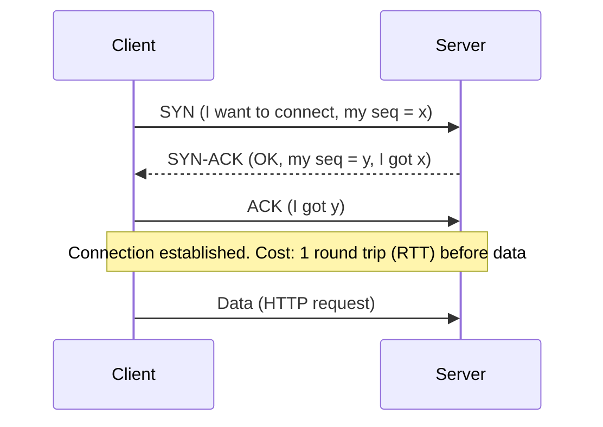
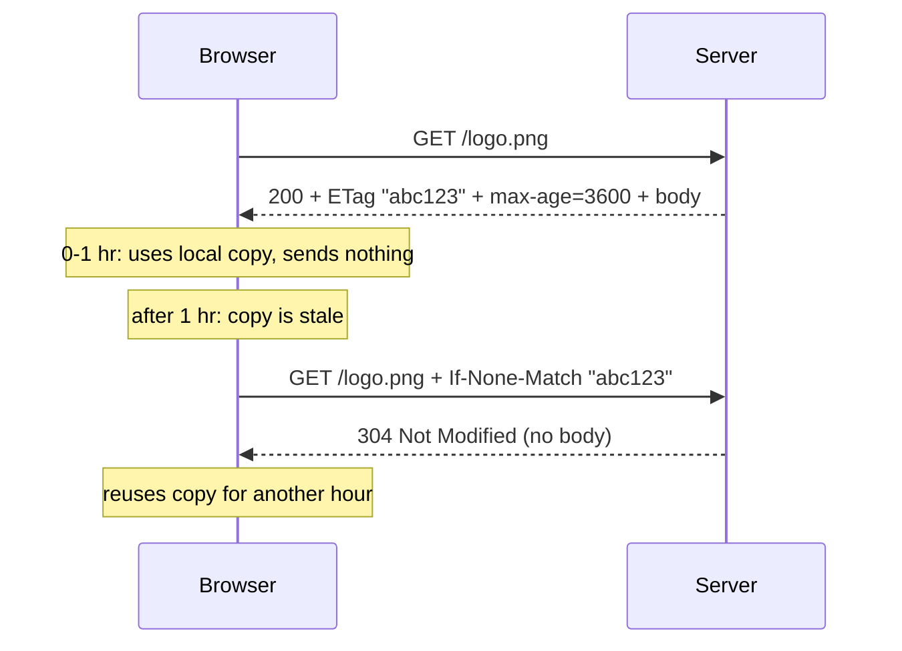
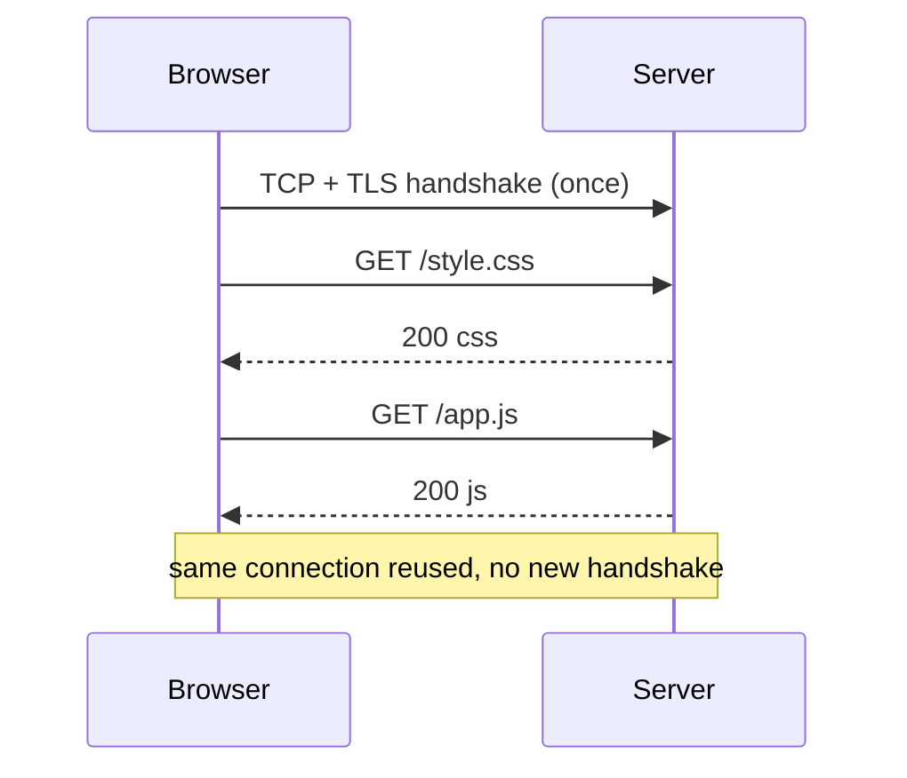
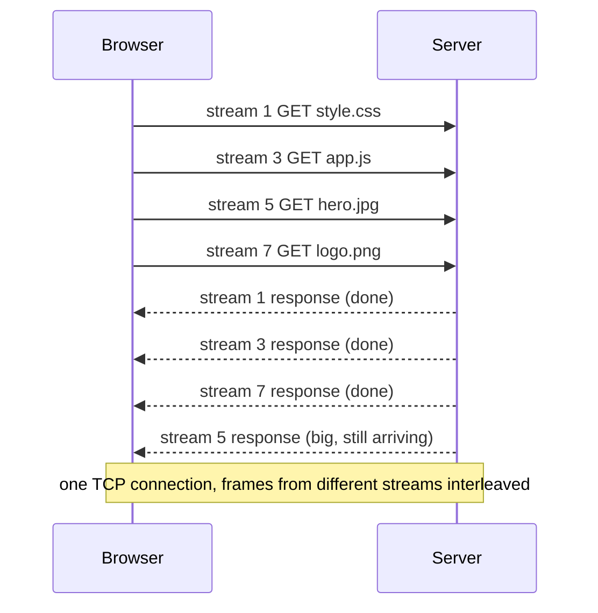
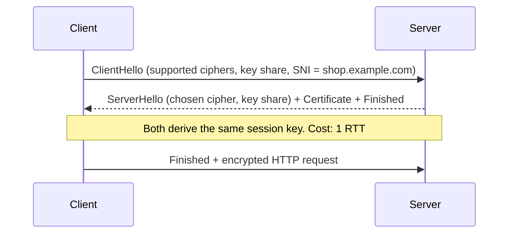

# 1.2 Networking Basics

Goal: understand **how bytes actually get from a client to a server**, what TCP, UDP, HTTP/1.1, HTTP/2, HTTP/3 and TLS are, why each exists, and how they affect latency and design choices.

---

## 0. The layered model

Networking is built in layers. Each layer solves one problem and relies on the layer below.

| Layer | Problem it solves | Examples |
| --- | --- | --- |
| **Application** | What do the two programs say to each other? | HTTP, gRPC, DNS, SMTP, WebSocket |
| **Security** (sits between app and transport) | Keep it private and verify who I'm talking to | TLS |
| **Transport** | Get data to the right *program*, optionally reliably | TCP, UDP, QUIC |
| **Network** | Get packets to the right *machine* across many networks | IP |
| **Link** | Move bits across one physical hop | Ethernet, Wi-Fi |

Your HTTP request is wrapped like nested envelopes:

```
[ Ethernet frame [ IP packet [ TCP segment [ TLS record [ HTTP request ] ] ] ] ]
```

For HLD you mostly need to understand **IP, TCP/UDP, TLS and HTTP**.

---

## 1. IP and ports

### IP address
An **IP address** identifies a machine (really, a network interface) on a network.
- **IPv4**: `203.0.113.10` (32-bit, ~4.3 billion addresses, running out).
- **IPv6**: `2001:db8::1` (128-bit, practically unlimited).
- **Public IP**: reachable from the internet. **Private IP** (`10.x.x.x`, `192.168.x.x`): only inside a local/cloud network; a **NAT** device translates between private and public.

### What IP gives you (and doesn't)
IP is **best-effort**. It delivers packets (small chunks of data, ~1500 bytes max, the **MTU**) but promises nothing: packets can be **lost, duplicated, delayed, or arrive out of order**.

### Port
One machine runs many programs. A **port** (0-65535) identifies which program receives the data.

| Port | Service |
| --- | --- |
| 80 | HTTP |
| 443 | HTTPS |
| 22 | SSH |
| 53 | DNS |
| 5432 / 3306 / 6379 | PostgreSQL / MySQL / Redis |

A **socket** is `(IP, port)`. A connection is uniquely identified by the **4-tuple**:

```
(client IP, client port, server IP, server port)
```

The client's port is a random **ephemeral port** (e.g. 53412) chosen by the OS.

> Interview relevance: a single client IP talking to a single server IP:port has at most ~64k ephemeral ports available, so a proxy/LB opening many connections to one backend can run out of ports ("port exhaustion"). Connection pooling and reuse avoid this.

---

## 2. TCP (Transmission Control Protocol)

### The problem it solves
IP gives unreliable packets. Most applications (web pages, file transfers, database queries) need a **reliable, ordered stream of bytes**. TCP builds that on top of IP.

### What TCP guarantees
- **Reliability**: lost data is retransmitted.
- **Ordering**: bytes arrive in the order sent.
- **No duplicates**.
- **Flow control**: the sender doesn't overwhelm the *receiver*.
- **Congestion control**: the sender doesn't overwhelm the *network*.

### How: sequence numbers and ACKs
Every byte has a **sequence number**. The receiver sends **ACKs** saying "I've received everything up to byte N". If the sender doesn't see an ACK in time (or sees duplicate ACKs), it **retransmits**.

### Connection setup: the 3-way handshake
Before any data flows, both sides agree on starting sequence numbers.



Cost: **1 RTT** before the client can send its first request byte. If the RTT is 100 ms, that's 100 ms gone.

### Flow control
The receiver advertises a **window size** ("I have buffer space for N more bytes"). The sender never has more than that unacknowledged.

### Congestion control
The sender doesn't know the network capacity, so it probes:
- **Slow start**: begin with a small **congestion window** (e.g. 10 packets) and roughly double each RTT while all goes well.
- On packet loss, **cut the window** (network is congested) then grow more carefully.

Consequence: a **new connection starts slow**. A fresh connection can't use the full bandwidth immediately, so short transfers on new connections are latency-bound. This is another strong reason to **reuse connections**.

### Connection teardown
Closed with `FIN` / `ACK` exchange. The side that closes first enters **TIME_WAIT** (~60 s) to be safe against late packets. Lots of short-lived connections = many sockets stuck in TIME_WAIT, which is another reason for keep-alive/pooling.

### Head-of-line (HOL) blocking in TCP
TCP delivers bytes strictly in order. If packet 5 is lost, packets 6, 7, 8 may have arrived but **must wait** until 5 is retransmitted. Everything on that connection stalls. Remember this; it motivates HTTP/3.

---

## 3. UDP (User Datagram Protocol)

### What it is
A thin layer over IP: just adds **ports** (and a checksum). No handshake, no ACKs, no retransmission, no ordering, no congestion control.

```
Client ---- datagram ----> Server      (fire and forget)
```

### Why would anyone want that?
- **Lower latency**: no handshake; send immediately.
- **No head-of-line blocking**: each datagram is independent.
- **Application controls the behaviour**: a video call prefers to **drop** a late frame rather than wait for retransmit.
- Supports **broadcast/multicast**.

### TCP vs UDP

| | TCP | UDP |
| --- | --- | --- |
| Connection | Yes (handshake) | No (connectionless) |
| Reliability | Guaranteed delivery, retransmits | None |
| Ordering | In order | Not guaranteed |
| Speed / overhead | Slower, more overhead | Faster, minimal overhead |
| Flow/congestion control | Yes | No |
| Message boundaries | No (it's a byte stream) | Yes (each datagram is a unit) |
| Typical use | Web, APIs, databases, file transfer, email | DNS, live video/voice, gaming, metrics, QUIC/HTTP3 |

### When to choose which (interview framing)
- **Correctness matters more than a few ms** (payments, web pages, DB queries) → **TCP**.
- **Freshness matters more than completeness** (live audio, game state, telemetry samples) → **UDP**.
- UDP-based protocols can add **their own** reliability where needed (that's what QUIC does).

---

## 4. HTTP: the application protocol of the web

**HTTP (HyperText Transfer Protocol)** is a request/response protocol: client sends a request, server returns a response. It is **stateless**: each request is independent and carries everything needed (cookies/tokens identify the user).

### Request/response anatomy
```
POST /orders HTTP/1.1                  <- method, path, version
Host: shop.example.com                 <- headers
Content-Type: application/json
Authorization: Bearer eyJ...

{"productId": 42, "qty": 2}            <- body
```
```
HTTP/1.1 201 Created                   <- status line
Content-Type: application/json
Location: /orders/9001

{"orderId": 9001}
```

### Methods
| Method | Meaning | Safe? | Idempotent? |
| --- | --- | --- | --- |
| GET | Read | Yes | Yes |
| POST | Create / action | No | **No** |
| PUT | Replace | No | Yes |
| PATCH | Partial update | No | Not necessarily |
| DELETE | Remove | No | Yes |

*Idempotent* = repeating it has the same effect as doing it once. This matters for **retries** (why POST payments need idempotency keys, see 4.2).

### Status codes
- **2xx** success: `200 OK`, `201 Created`, `204 No Content`
- **3xx** redirect: `301/302`, `304 Not Modified` (cache validation)
- **4xx** client's fault: `400`, `401` (not authenticated), `403` (forbidden), `404`, `409` (conflict), `429` (rate limited)
- **5xx** server's fault: `500`, `502` (bad gateway, upstream returned garbage), `503` (unavailable/overloaded), `504` (gateway timeout)

### Caching headers
Browsers and CDNs can keep a copy of a response. These headers say **how long the copy is valid** and **how to check whether it is still current**.

**`Cache-Control: max-age=3600` — "reuse this without asking me"**

The copy is *fresh* for 3600 s. During that hour the browser uses its stored copy and sends **no request at all** (0 ms, no server load). After that the copy is *stale* and the browser must go back to the server.

Other values: `public` (any cache, including CDNs, may store it), `private` (only the user's browser), `no-store` (never cache, e.g. banking pages), `no-cache` (may store, but must revalidate before every use).

**`ETag` + `If-None-Match` — "I have a copy, is it still current?"**

An **ETag** is a fingerprint (hash or version id) of the content, sent with the first response:

```
GET /logo.png
-> 200 OK
   ETag: "abc123"
   Cache-Control: max-age=3600
   [2 MB of image bytes]
```

Once the copy is stale, the browser sends the fingerprint back instead of blindly re-downloading:

```
GET /logo.png
If-None-Match: "abc123"       <- "I have version abc123, still good?"
```

- **Unchanged** → `304 Not Modified`, no body (a few hundred bytes). The browser reuses its copy and the freshness timer restarts.
- **Changed** → `200 OK` with the new body and a new `ETag: "def456"`.



| Mechanism | What it saves |
| --- | --- |
| `max-age` | The **request itself** (no round trip, no server work) |
| `ETag` + `304` | The **response body** (still one round trip, but tiny) |

`Last-Modified` / `If-Modified-Since` is the same idea using a timestamp instead of a fingerprint.

**Design tip:** give static files a long `max-age` and put a version in the file name (`app.3f9a1c.js`) so a deploy creates a new URL; give HTML/API responses a short `max-age` or rely on `ETag` revalidation. CDNs use these same headers to decide how long to keep content at the edge.

### Cookies
Server sets `Set-Cookie: session=abc`; browser sends it back on later requests. This is how a stateless protocol carries a login.

---

## 5. HTTP/1.1

We'll use one running example for both HTTP/1.1 and HTTP/2.

> **The example page.** The user opens `https://shop.example.com/`. The browser gets the HTML, then discovers it needs four more files:
>
> | File | Size | Server time |
> | --- | --- | --- |
> | `style.css` | small | 10 ms |
> | `app.js` | small | 10 ms |
> | `hero.jpg` | big (slow to send) | ~300 ms |
> | `logo.png` | small | 10 ms |
>
> Network round trip time (RTT) between browser and server: **100 ms**.

### 5.1 What HTTP/1.1 is
A **text** protocol. Everything on the wire is human-readable:

```
GET /style.css HTTP/1.1
Host: shop.example.com
Accept: text/css
Cookie: session=abc123; theme=dark; ...
Connection: keep-alive

```
```
HTTP/1.1 200 OK
Content-Type: text/css
Content-Length: 2048

body { margin: 0; ... }
```

Rules of the protocol:
- The `Host` header is mandatory. One IP can host many sites, so the server uses it to know which site you want.
- The response must say where it ends: `Content-Length: 2048` (exact size), or `Transfer-Encoding: chunked` (size unknown up front, sent in pieces, e.g. streamed output).
- On one connection, **a response must be fully finished before the next one can start**. HTTP/1.1 has no way to label "this chunk belongs to response A" and "that chunk belongs to response B", because there is no concept of separate streams.

### 5.2 Improvement over HTTP/1.0: persistent connections (keep-alive)
HTTP/1.0 opened a **new TCP connection for every request**. For our 5 resources that meant 5 TCP handshakes (and 5 TLS handshakes, and 5 slow starts).

HTTP/1.1 keeps the connection open by default (`Connection: keep-alive`) and **reuses it** for the next request. One handshake, many requests.



### 5.3 The real limitation: one request at a time per connection
With one connection, the browser must **wait for each response to finish** before sending the next request. Requests queue up in a line.

Our example on a single connection (handshake already done, after the HTML arrived):

```
time (ms)  0         100       200                 600       700
           |---------|---------|-------------------|---------|
 style.css [req+resp 110]
 app.js              [req+resp 110]
 hero.jpg                      [req+wait+big transfer ... 400]
 logo.png                                           [req+resp 110]   <- tiny file, stuck waiting
                                                                    total: ~730 ms
```

The tiny `logo.png` (10 ms of work) sits idle for ~600 ms purely because the big `hero.jpg` is in front of it. This is **HTTP-level head-of-line (HOL) blocking**: one slow item at the head of the queue blocks everything behind it.

**Pipelining** (sending the next request without waiting for the previous response) was added to HTTP/1.1 to help. It failed in practice: responses still had to come back **in order** (so HOL blocking remained), and buggy proxies broke it. Browsers disabled it.

### 5.4 The workarounds web developers invented

| Workaround | Idea | Cost |
| --- | --- | --- |
| **~6 parallel connections per host** (browser default) | Several lines instead of one | Each new connection pays TCP + TLS handshake and TCP slow start; more server memory; connections compete with each other for bandwidth |
| **Domain sharding** (`img1.example.com`, `img2.example.com`) | More hostnames means more allowed connections | More DNS lookups, more handshakes, even more connections |
| **Bundling** (one big `bundle.js`, one CSS file) and **image sprites** | Fewer requests | Change one line and the whole bundle must be re-downloaded and re-cached; downloads code the page doesn't need |
| **Inlining** small assets into HTML (base64) | No separate request | Can't be cached separately; bigger HTML |

Our example using 6 connections: the 4 resources load in parallel, so the total is about `200 ms` (extra TCP+TLS setup for the new connections, 2 RTT) `+ 400 ms` (the slowest, hero.jpg) = **~600 ms**. Better than 730 ms, but we paid for it with extra connections.

### 5.5 Another cost: repeated headers
Every request repeats the same headers as plain text, notably the cookie:

```
Cookie: session=eyJhbGciOi...(800 bytes)...; theme=dark; ...
User-Agent: Mozilla/5.0 (Windows NT 10.0; ...)
Accept-Language: en-US,en;q=0.9
```

If a page makes 80 requests with 1 KB of headers each, that's **80 KB of identical headers** sent upstream. On a slow uplink this matters.

### 5.6 HTTP/1.1 summary
- Text protocol, persistent connections.
- Only **one in-flight request per connection** → HOL blocking.
- Work-arounds (multiple connections, sharding, bundling) are costly hacks.
- Still everywhere: simple clients, `curl`, many internal services, and what many load balancers speak to backends.

---

## 6. HTTP/2

### 6.1 The core idea
HTTP/2 keeps the **same meaning** as HTTP/1.1 (same methods like `GET`/`POST`, same headers, same status codes like `200`/`404`, same URLs). Your application code mostly doesn't change. What changes is **how the messages are packaged on the wire**.

HTTP/1.1 sends messages as plain text, one after another. HTTP/2 chops every message into small **binary frames**, tags each frame with a **stream ID**, and lets frames from different requests be **mixed together on one TCP connection**.

### 6.2 Streams, frames, and multiplexing

- **Connection**: one TCP connection (with TLS) between client and server.
- **Stream**: one request + its response, identified by a number (client-initiated streams use odd IDs: 1, 3, 5, 7...).
- **Frame**: the smallest unit on the wire. Types include `HEADERS` (the request/response headers), `DATA` (body bytes), `SETTINGS`, `RST_STREAM` (cancel one stream), `GOAWAY` (graceful shutdown). Each frame carries its stream ID so the receiver can reassemble streams.

Our example page, loading all four resources at once on **one connection**:

```
Client -> Server (all sent immediately, no waiting):
  [HEADERS stream 1: GET /style.css]
  [HEADERS stream 3: GET /app.js]
  [HEADERS stream 5: GET /hero.jpg]
  [HEADERS stream 7: GET /logo.png]

Server -> Client (interleaved as each becomes ready):
  [HEADERS s1: 200] [DATA s1: css bytes]   [END_STREAM]   <- style done
  [HEADERS s3: 200] [DATA s3: js bytes]    [END_STREAM]   <- app.js done
  [HEADERS s7: 200] [DATA s7: png bytes]   [END_STREAM]   <- logo done, did NOT wait for hero
  [HEADERS s5: 200] [DATA s5: jpg part 1]
  [DATA s5: jpg part 2] ...                [END_STREAM]   <- hero done last
```



**Timing (same simplified numbers as before):** all four requests leave at once. `style.css`, `app.js` and `logo.png` come back at ~110 ms. `hero.jpg` finishes at ~400 ms. **Total ~400 ms on ONE connection**, versus ~730 ms (1 connection) or ~600 ms (6 connections) with HTTP/1.1. The tiny logo no longer waits behind the big image.

| | HTTP/1.1 | HTTP/2 |
| --- | --- | --- |
| Connections for the page | 1 to 6 | **1** |
| Handshakes (TCP + TLS) | up to 6 | **1** |
| Request concurrency | 1 per connection (6 total) | **Many (typically 100+) per connection** |
| Small file behind a big file | Waits | **Doesn't wait** |

### 6.3 Header compression (HPACK)
Remember the repeated 1 KB of headers on every HTTP/1.1 request? HTTP/2 compresses headers using **HPACK**:

- Client and server each keep a **table** of headers already seen on this connection.
- The first request sends full headers: `cookie: session=eyJ...; user-agent: Mozilla/5.0 ...` and both sides add them to the table.
- Later requests just say "same as table entry #62", costing a few **bytes** instead of ~1 KB.

Example: 80 requests × 1 KB = 80 KB in HTTP/1.1. In HTTP/2: ~1 KB for the first, then roughly 20-50 bytes each = about 4-5 KB total.

HPACK is deliberately designed (not generic gzip) to avoid security attacks like CRIME that exploited compressed headers.

### 6.4 Flow control and prioritisation
- **Flow control per stream**: each stream has a window of how much data the receiver will accept. A slow consumer of one stream can't force the whole connection to buffer unlimited data.
- **Prioritisation**: the browser can hint "CSS and JS matter more than the hero image" so the server sends critical frames first. (Support quality varies; HTTP/3 simplified this.)

### 6.5 Server push (mostly dead)
Idea: server sees you asked for `index.html` and proactively sends `style.css` too, before you ask. In practice it was hard to use well (it re-sent files the browser had cached) and **browsers have removed it**. Know it exists, don't build on it.

### 6.6 How it's negotiated
Over HTTPS, during the TLS handshake the client and server agree on the protocol using **ALPN** (Application-Layer Protocol Negotiation): the client says "I can speak `h2` and `http/1.1`", the server picks `h2`. Browsers only use HTTP/2 over TLS, so no extra round trip is needed.

### 6.7 What HTTP/2 does NOT fix: TCP head-of-line blocking
HTTP/2 removed HOL blocking at the **HTTP level**, but all the streams still ride on **one TCP connection**, and TCP delivers bytes strictly in order.

Example: the server sends packets 1-10, carrying frames from streams 1, 3, 5 and 7. **Packet 4 is lost** (it only held data for stream 3). Packets 5-10 arrive, including complete data for streams 1 and 7, but TCP **refuses to hand anything after packet 4 to the application** until packet 4 is retransmitted (~1 RTT later).

```
Packets:   1   2   3  [4 lost]  5   6   7   8   9   10
TCP hands to HTTP/2:  1 2 3 ........ WAIT ........ then 4 5 6 7 8 9 10
                                    ^ ALL streams frozen, even those whose data already arrived
```

On a clean network (data centre, good Wi-Fi) packet loss is rare, so this is invisible. On **lossy networks (mobile, congested Wi-Fi)**, a single lost packet freezes every stream, and HTTP/2 can be **worse** than HTTP/1.1 with 6 connections (where a loss only stalls 1 of 6). This is exactly the problem **HTTP/3 / QUIC** (next section) solves.

### 6.8 What changes in how you build things
HTTP/1.1-era hacks become unnecessary or even harmful on HTTP/2:
- **Domain sharding**: harmful (splits the connection you want to be one).
- **Heavy bundling / sprites**: less needed; many small files multiplex fine, and caching per file works better.
- **Fewer connections** means less load on servers and load balancers, but **each connection is long-lived and carries many requests** (see the L4 balancing trap in 1.1).

### 6.9 HTTP/2 in system design
- Default for modern browsers talking to a site or CDN.
- The transport underneath **gRPC**: many concurrent RPCs multiplexed on one connection, plus bidirectional streaming. Service-to-service gRPC calls reuse a few long-lived connections instead of one per call.
- Common deployment: the **load balancer/CDN speaks HTTP/2 to the client** and **HTTP/1.1 (or HTTP/2) to backends**. The edge terminates TLS and translates.
- **Load balancing caution**: with gRPC/HTTP/2, an **L4** LB balances once per connection, so one client's many multiplexed requests all land on the same backend. Use an **L7 / gRPC-aware LB** (Envoy, ALB) or client-side balancing so requests are spread per call.

### 6.10 HTTP/1.1 vs HTTP/2 at a glance

| | HTTP/1.1 | HTTP/2 |
| --- | --- | --- |
| Format | Text | Binary frames |
| Requests in flight per connection | 1 | Many (multiplexed streams) |
| HOL blocking | HTTP level and TCP level | TCP level only |
| Header handling | Full text on every request | HPACK compression |
| Connections per host (browser) | ~6 | 1 |
| Handshakes per page | Several | One |
| Server push | No | Existed, now removed from browsers |
| Typical weakness | Slow with many small resources | Lossy networks (TCP HOL) |

---

## 7. HTTP/3 and QUIC

### The one-sentence idea
HTTP/2 has a flaw that comes from TCP. HTTP/3 fixes it by **replacing TCP with a new protocol called QUIC**, which runs on top of UDP.

- **HTTP/3** = HTTP (same methods, headers, status codes) running over QUIC.
- **QUIC** = a new transport protocol that does what TCP + TLS do, but better. It is built on UDP because UDP is the only thing that can pass through the internet's routers and firewalls without being blocked.

```
HTTP/2:   HTTP  ->  TLS  ->  TCP   ->  IP
HTTP/3:   HTTP  ->  QUIC (includes TLS)  ->  UDP  ->  IP
```

### Problem 1: one lost packet freezes everything (TCP head-of-line blocking)
Recall from HTTP/2: all streams share one TCP connection, and TCP delivers data strictly in order. One lost packet makes **every** stream wait.

QUIC knows about streams. Each stream is ordered **separately**:

```
HTTP/2 (TCP):   packet for stream 3 is lost
                -> stream 1, 5, 7 ALSO freeze until it is resent

HTTP/3 (QUIC):  packet for stream 3 is lost
                -> only stream 3 waits
                -> stream 1, 5, 7 keep loading normally
```

In our example page: if a packet of `app.js` is lost, the logo and CSS still finish on time. Only `app.js` is delayed.

### Problem 2: slow connection setup
Before the first request, HTTP/2 needs two separate handshakes: TCP, then TLS.

```
HTTP/2 (new connection):
  TCP handshake      1 round trip
  TLS handshake      1 round trip
  Request/response   1 round trip
  -> 3 round trips before you get the first byte   (300 ms at 100 ms RTT)

HTTP/3 (new connection):
  QUIC + TLS together   1 round trip
  Request/response      1 round trip
  -> 2 round trips                                  (200 ms)

HTTP/3 (returning visitor, "0-RTT"):
  Request is sent in the very first packet
  -> 1 round trip                                   (100 ms)
```

QUIC saves a round trip by doing the transport setup and the encryption setup **in the same exchange**. For a returning visitor, the client remembers keys from last time and can send the request right away.

### Problem 3: switching networks breaks the connection
A TCP connection is identified by `(your IP, your port, server IP, server port)`. If your IP changes, the connection is dead.

Example: you're watching a video on Wi-Fi, walk out of the house, and your phone switches to mobile data. Your IP changes. With TCP, the connection breaks and the app has to reconnect, so you see buffering.

QUIC identifies a connection by a **connection ID** (a random number), not by IP. When your IP changes, you keep using the same ID and the connection **continues without interruption**. This is called **connection migration**.

### Trade-offs
- **UDP is sometimes blocked** by corporate firewalls, so browsers fall back to HTTP/2 automatically.
- **More CPU:** QUIC runs inside the application (not in the operating system like TCP) and is always encrypted.
- **Less mature tooling:** fewer load balancers and monitoring tools support it well yet.
- **Biggest benefit is on bad networks:** mobile, high latency, packet loss. On a fast, clean network, HTTP/2 and HTTP/3 feel about the same.

### In practice
- Usually enabled at the **CDN / edge**: the browser talks HTTP/3 to the CDN, and the CDN talks HTTP/2 or HTTP/1.1 to your servers.
- A browser learns a site supports HTTP/3 from a response header (`Alt-Svc: h3=":443"`), then uses it on the next connection.

### Comparison table

| | HTTP/1.1 | HTTP/2 | HTTP/3 |
| --- | --- | --- | --- |
| Transport | TCP | TCP | QUIC (UDP) |
| Format | Text | Binary frames | Binary frames |
| Concurrency on one connection | No (1 request at a time) | Yes (multiplexed streams) | Yes (multiplexed streams) |
| Header compression | No | HPACK | QPACK |
| HOL blocking | HTTP + TCP level | TCP level only | None across streams |
| Handshake (new conn, HTTPS) | TCP 1 RTT + TLS 1-2 RTT | Same as 1.1 | ~1 RTT total (0 RTT resumed) |
| Typical use | Legacy, simple clients, internal | Default web, gRPC | Modern CDNs, mobile, streaming |

---

## 8. TLS (Transport Layer Security)

### The problem
Plain HTTP travels as readable text. Anyone on the path (Wi-Fi owner, ISP, router) can **read** it, **modify** it, or **impersonate** the server.

### What TLS provides (HTTPS = HTTP over TLS)
1. **Confidentiality**: data is **encrypted**.
2. **Integrity**: tampering is detected.
3. **Authentication**: the client verifies it's talking to the **real** `shop.example.com`.

### Two kinds of cryptography working together
- **Asymmetric (public/private key)**: slow, but lets two parties who never met agree on a secret safely, and prove identity (signatures).
- **Symmetric (a shared session key, e.g. AES)**: fast, used to encrypt all the actual data.

TLS uses asymmetric crypto **only in the handshake** to establish a symmetric session key, then switches to symmetric for the data.

### How asymmetric crypto works (the part people skip)
Each side has a **key pair**: a **public key** (shared with everyone) and a **private key** (never leaves its owner). What one key does, only the other can undo:

| Operation | Done with | Checked/undone with | Purpose |
| --- | --- | --- | --- |
| Encrypt | public key | private key | Only the private-key owner can read it |
| Sign | private key | public key | Proves the private-key owner produced it |

**A. Agreeing on a secret (Diffie-Hellman key exchange).** Each side mixes a private number with public numbers and sends only the result. Both end up with the same secret without ever sending it. Paint analogy:

```
Public (everyone sees): yellow
Client: secret red  + yellow -> orange  (sends orange)
Server: secret blue + yellow -> green   (sends green)
Client: green  + own red  -> brown
Server: orange + own blue -> brown      Both have brown. An eavesdropper saw
                                        yellow, orange, green, but can't un-mix paint.
```

Same thing with small real numbers:

```
Public: p = 23, g = 5
Client secret a = 6   -> sends A = 5^6  mod 23 = 8
Server secret b = 15  -> sends B = 5^15 mod 23 = 19
Client computes B^a mod 23 = 19^6 mod 23 = 2
Server computes A^b mod 23 = 8^15 mod 23 = 2      <- same secret, never sent
```

An eavesdropper sees `23, 5, 8, 19` but needs `a` or `b` to get the secret. With real 256-bit numbers that is computationally infeasible.

**B. Proving identity (digital signature).** The server's certificate holds its public key. In the handshake the server **signs** the handshake data with its **private key**; the client **verifies** the signature with the public key from the certificate. Only the holder of the private key can produce a valid signature, so an impostor who copied the public certificate still fails.

**Why both are needed:** Diffie-Hellman alone is vulnerable to a man-in-the-middle who runs a separate exchange with each side and reads everything. The signature (backed by the CA-signed certificate) proves the other end really is `shop.example.com`.

The agreed secret then becomes the fast **symmetric key** (AES) for all the actual data.

### Certificates and trust
A server proves its identity with a **certificate**: "public key X belongs to `shop.example.com`", **signed by a Certificate Authority (CA)** (Let's Encrypt, DigiCert...). Your browser/OS ships with a list of **trusted root CAs** and verifies the chain:

```
Root CA (trusted by OS) --signs--> Intermediate CA --signs--> shop.example.com certificate
```

If the certificate is expired, for the wrong domain, or not signed by a trusted CA, the browser shows a warning.

### TLS 1.3 handshake (simplified)

- **TLS 1.2**: 2 RTT. **TLS 1.3**: **1 RTT**, and **0-RTT** on session resumption (with replay-attack caveats, so use it only for idempotent requests).
- **SNI (Server Name Indication)**: the client states the hostname so one IP can serve many domains' certificates.

### Total cost of a brand-new HTTPS connection (TCP + TLS 1.3)
```
DNS lookup           ~ 1 RTT (if not cached)
TCP handshake        1 RTT
TLS 1.3 handshake    1 RTT
HTTP request/response 1 RTT
-----------------------------
~ 3-4 RTTs before the first byte of the response
```
With a 100 ms RTT, that is **300-400 ms** before content arrives. HTTP/3 reduces it, connection reuse removes it for later requests.

### TLS termination (where encryption ends)
Decrypting is CPU work and needs certificate management. Options:
- **Terminate at the edge (CDN / L7 LB)**: backends receive plain HTTP inside a trusted private network. Simplest; central cert management; lets the LB inspect HTTP.
- **TLS passthrough (L4)**: LB forwards encrypted bytes; backend decrypts. End-to-end encryption, but the LB can't read HTTP.
- **Re-encrypt to backend**: terminate at the LB, then new TLS to backend (compliance requirement; costs CPU).
- **mTLS (mutual TLS)**: *both* sides present certificates; common between microservices for service identity.

---

## 9. How these choices show up in system design

### Connection reuse is everything
Every new connection pays handshake RTTs and TCP slow start. So:
- **Keep-alive** between client and LB.
- **Connection pools** from app servers to databases/caches/other services (DB connections are expensive; pools are bounded).
- **LB-to-backend persistent connections**.

### Choosing the protocol for a use case

| Scenario | Pick | Why |
| --- | --- | --- |
| Public website / REST API | HTTPS over HTTP/2 (HTTP/3 at CDN) | Multiplexing, compression, ubiquity |
| Internal service-to-service, many small calls | gRPC (HTTP/2) | Streams, binary, typed contracts |
| Live video call, VoIP, online gaming | UDP (WebRTC, custom) | Latency over perfect delivery |
| Live updates in a browser | WebSocket / SSE (over TCP) | Long-lived connection, server push (see 4.3) |
| DNS lookups | UDP (TCP fallback for large responses) | Tiny request/response, speed |
| Mobile app on flaky networks | HTTP/3 | Connection migration, no TCP HOL |
| Metrics/log shipping where loss is OK | UDP (e.g. StatsD) | Cheap, fire and forget |

### Long-lived connections and capacity
WebSocket/chat/streaming servers hold **hundreds of thousands of open connections**. Each connection costs memory (buffers, file descriptor, state), so you tune OS limits and use event-driven servers (epoll, async I/O) rather than a thread per connection (the **C10K / C1M problem**). Load balancers must support long-lived connections (idle timeouts!) and graceful draining on deploy.

### Timeouts
Every network call needs timeouts: connect timeout, read timeout, overall deadline. Without them, a slow dependency holds sockets and threads and cascades into an outage (see 4.6).

### Latency physics
Within a data centre RTT ~0.5 ms; same continent 30-80 ms; across oceans 100-250 ms. You can't make light faster: the way to cut latency is **fewer round trips** (reuse, HTTP/2/3, batching) and **moving data closer** (CDN, regional deployments).

---

## 10. Common pitfalls

- Saying "TCP is slow, UDP is fast" without explaining the trade-off (reliability, ordering, congestion control).
- Thinking HTTP/2 removes all head-of-line blocking (only at the HTTP layer; TCP still blocks).
- Treating one HTTP/2 or keep-alive connection through an **L4** LB as per-request balanced (it's pinned to one backend).
- Opening a new connection (or new DB connection) for every request.
- Forgetting that retrying a non-idempotent `POST` can duplicate the effect.
- No timeouts on outbound calls.
- Assuming a client's IP is visible to backends behind a proxy (it's in `X-Forwarded-For` / PROXY protocol).

---

## 11. Interview questions with model answers

**Q1. TCP vs UDP: what's the difference and when would you use each?**
TCP is connection-oriented and gives reliable, ordered delivery with flow and congestion control, at the cost of handshake latency and head-of-line blocking. UDP is connectionless, with no guarantees but minimal latency and no blocking. Use TCP for web/APIs/databases where correctness matters; UDP for live media, games, DNS, or when the app implements its own reliability (QUIC).

**Q2. Walk through what happens when a client opens an HTTPS connection.**
(DNS) → TCP SYN / SYN-ACK / ACK → TLS ClientHello / ServerHello + certificate → client validates the certificate chain, both derive session keys → encrypted HTTP request flows. About 2 RTTs of setup before the first request with TLS 1.3.

**Q3. HTTP/1.1 vs HTTP/2 vs HTTP/3?**
1.1: text, one request at a time per connection (browsers open ~6 connections). 2: binary framing, multiplexed streams on a single TCP connection, header compression, but TCP HOL blocking remains. 3: HTTP over QUIC/UDP, per-stream loss recovery, faster handshake, connection migration.

**Q4. Why is connection reuse important?**
Each new connection costs handshake RTTs (TCP + TLS) and starts with a small congestion window. Reuse (keep-alive, pooling) amortises that, saves CPU for TLS, and avoids port/TIME_WAIT exhaustion.

**Q5. What does TLS give you, and how does it work at a high level?**
Confidentiality, integrity, authentication. Asymmetric crypto in the handshake authenticates the server via a CA-signed certificate and agrees on a shared secret; then fast symmetric encryption protects the data.

**Q6. Where should TLS terminate?**
Usually at the edge/L7 LB for central cert management and HTTP-level routing, with plain or re-encrypted traffic to backends inside the private network. Use passthrough or mTLS where end-to-end encryption or service identity is required.

**Q7. Why might an L4 load balancer distribute load unevenly with HTTP/2 or keep-alive clients?**
It balances per **connection**. A client that multiplexes lots of requests over one long-lived connection stays on one backend. An L7 LB balances per request.

**Q8. Why do some systems use UDP for real-time features?**
A late packet is useless (a video frame from 2 s ago), so waiting for TCP's retransmit and in-order delivery hurts. UDP lets the app drop or conceal losses and avoids head-of-line blocking.

**Q9. What is head-of-line blocking?**
A stalled item at the front of a queue blocks everything behind it. HTTP/1.1: a slow response blocks the next request on that connection. TCP: one lost packet blocks all later bytes. HTTP/2 fixes the first; HTTP/3 (QUIC) fixes the second for independent streams.

**Q10. [Senior] How would you reduce latency for users on mobile networks globally?**
Terminate TLS and use HTTP/3 at a nearby CDN edge (fewer round trips, connection migration), reuse long-lived connections from edge to origin, regional deployments or caches, compress and batch requests, and set sensible timeouts and retries with backoff.

---

## 12. One-page summary

| Concept | Remember |
| --- | --- |
| **IP** | Addresses machines; best-effort packets, no guarantees |
| **Port** | Selects the program; connection = (src IP, src port, dst IP, dst port) |
| **TCP** | Reliable, ordered byte stream; 3-way handshake (1 RTT); flow + congestion control; HOL blocking |
| **UDP** | Fast, connectionless, no guarantees; good for real-time, DNS, QUIC |
| **HTTP** | Stateless request/response; know methods, idempotency, status codes, cache headers |
| **HTTP/1.1** | Keep-alive, but 1 request at a time per connection |
| **HTTP/2** | Multiplexed streams over one TCP connection, HPACK; TCP HOL remains |
| **HTTP/3** | HTTP over QUIC (UDP): no cross-stream HOL, 1-RTT/0-RTT setup, connection migration |
| **TLS** | Encrypts, authenticates (certificates/CAs), protects integrity; 1 RTT in TLS 1.3 |
| **Design takeaway** | Minimise round trips: reuse connections, pool, put TLS and content near users |
