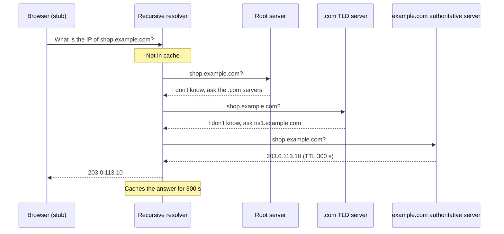
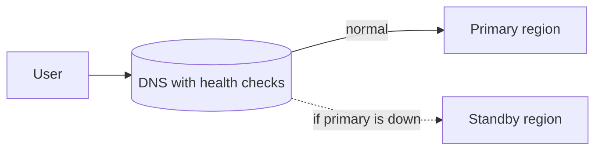

# 1.3 DNS

Goal: understand what DNS is, how a lookup really works, what TTL and caching mean, and how DNS is used in system design (load balancing, failover, routing users to the nearest region).

---

## 1. What problem does DNS solve?

Computers find each other with **IP addresses** (`203.0.113.10`). People use **names** (`shop.example.com`). DNS (**Domain Name System**) is the system that translates names into IP addresses.

```
shop.example.com   ->   203.0.113.10
```

Why not one big phone book file? The internet has billions of names that change constantly, and one central list would be a bottleneck and a single point of failure. So DNS is a **distributed, hierarchical database with heavy caching**.

Bonus: because a name is separate from an IP, you can change the server behind a name (move to a new data centre, add servers) without users noticing.

---

## 2. The name is a hierarchy

Read a domain name **right to left**:

```
         www . shop . example . com .
                                    ^ root (the invisible trailing dot)
                             ^^^ TLD (top-level domain)
                     ^^^^^^^ domain (what you registered)
              ^^^^ subdomain
       ^^^ subdomain
```

Each level is managed by a different set of servers, and each level only knows who manages the next level down.

| Level | Who runs it | What it knows |
| --- | --- | --- |
| **Root servers** (13 logical addresses, run on hundreds of machines) | Internet organisations | Where to find the `.com`, `.org`, `.in` servers |
| **TLD servers** (`.com`) | Registry (e.g. Verisign for `.com`) | Which name servers manage `example.com` |
| **Authoritative name servers** for `example.com` | **You** (or your DNS provider: Route 53, Cloudflare) | The actual records: the IP of `shop.example.com` |

"Authoritative" means "this server holds the real answer". Everyone else is just passing along or caching it.

---

## 3. How a lookup works (step by step)

Who is involved:

| Role | Job |
| --- | --- |
| **Stub resolver** | Small client built into your OS/browser. Just asks one question. |
| **Recursive resolver** | The workhorse (your ISP's, or `8.8.8.8` Google, `1.1.1.1` Cloudflare). Does all the searching for you and **caches** the answers. |
| **Root / TLD / authoritative servers** | Give referrals, and finally the answer. |



Key points:
- The **recursive** part is you asking the resolver and waiting for the final answer. The **iterative** part is the resolver asking each server in turn and getting referrals ("go ask them").
- This full walk costs **3 or 4 network round trips** (roughly 20-120 ms). It happens rarely, because of caching.
- DNS normally uses **UDP port 53** (one small request, one small reply, no handshake). It falls back to **TCP** if the response is too large.

---

## 4. Caching: why DNS is fast and why changes are slow

Answers are cached at every layer:

```
Browser cache -> OS cache -> Recursive resolver cache -> (full lookup)
```

- Popular names (`google.com`) are almost always already in the resolver's cache, so you get an answer in ~1-5 ms.
- Every answer carries a **TTL (Time To Live)** in seconds: "you may cache this for N seconds". When the TTL runs out, the cached copy is discarded and looked up again.

| TTL | Pros | Cons |
| --- | --- | --- |
| **Long** (86400 = 1 day) | Fewer lookups, faster for users, less load on your DNS | A change takes up to a day to reach everyone |
| **Short** (30-60 s) | Changes and failover take effect quickly | More lookups, slightly slower first request, more cost |

**Example: moving servers.** Your IP changes from `203.0.113.10` to `198.51.100.5`. With TTL = 1 day, some users keep hitting the old (maybe shut-down) server for up to 24 hours, because their resolver still holds the old answer and you can't force it to forget.

**Standard practice:** *before* a planned migration, lower the TTL (e.g. to 60 s) a day ahead, do the switch, then raise it again.

Other caching facts:
- Some resolvers and apps **ignore or stretch TTLs**, so don't rely on exact timing.
- **Negative caching:** "this name doesn't exist" (`NXDOMAIN`) is cached too.

---

## 5. Record types

A **record** is one entry in a domain's DNS zone (its list of settings).

| Record | Maps | Example |
| --- | --- | --- |
| **A** | name -> IPv4 address | `shop.example.com  A  203.0.113.10` |
| **AAAA** | name -> IPv6 address | `shop.example.com  AAAA  2001:db8::10` |
| **CNAME** | name -> **another name** (alias) | `www.example.com  CNAME  shop.example.com` |
| **NS** | who the authoritative servers are | `example.com  NS  ns1.example.com` |
| **MX** | where to send email | `example.com  MX  10  mail.example.com` |
| **TXT** | free text (domain ownership, email anti-spoofing like SPF) | `example.com  TXT  "v=spf1 ..."` |
| **SRV** | host and port for a service | `_sip._tcp.example.com  SRV  ...` |

### CNAME in practice
A CNAME says "this name is just another name for that one; go look that up instead".

```
www.example.com     CNAME   shop.example.com
shop.example.com    A       203.0.113.10
```

Asking for `www.example.com` follows the chain and ends with `203.0.113.10`.

This is how **CDNs** work: you point `cdn.example.com  CNAME  d111.cloudfront.net`, and the CDN's own DNS decides which edge server's IP to return for each user.

**Restriction:** a CNAME can't sit at the bare domain (`example.com`, the "apex"), because that name must also carry NS and MX records. Providers work around this with non-standard "ALIAS/ANAME" records (Route 53 calls it an Alias record).

### See it yourself
```
$ dig shop.example.com

;; ANSWER SECTION:
shop.example.com.   300   IN   A   203.0.113.10
                    ^^^ TTL left in seconds
```
Run it again a few seconds later and the TTL counts down (it's served from cache). On Windows use `nslookup shop.example.com`.

---

## 6. DNS as a load balancer and traffic router

Because the **same name can return different answers**, DNS can steer traffic. This is the first routing decision in any large system.

### 6.1 Round-robin DNS
Return several A records, and rotate their order on each query:

```
shop.example.com  A  203.0.113.10
shop.example.com  A  203.0.113.11
shop.example.com  A  203.0.113.12
```
Clients tend to use the first one, so load is spread roughly evenly. Simple and free.

**Weakness:** it doesn't check health. If `.11` dies, DNS still hands out its address, and cached answers stick around until their TTL expires.

### 6.2 Weighted routing
"Send 90% of answers to the old servers and 10% to the new ones." Used for gradual rollouts and canary releases.

### 6.3 Geo-based / latency-based routing
The DNS server picks an answer based on **where the user is** (from the resolver's IP) or on measured latency:

```
User in Mumbai  -> asks DNS -> gets IP of the Mumbai data centre
User in London  -> asks DNS -> gets IP of the London data centre
```
Result: each user talks to a nearby region, which is a big cut in latency (see 1.2: distance is the main enemy).

Caveat: DNS sees the **resolver's** location, not always the user's. A user on Google's `8.8.8.8` may be located by where that resolver sits. (A feature called EDNS Client Subnet partly fixes this.)

### 6.4 Health-checked failover
The DNS provider constantly probes your servers. If a region fails its checks, DNS **stops returning its IP** and returns the backup region's IP.



Limit: cached answers live on until their TTL expires, so failover takes **at least one TTL** (often a few minutes). Use a short TTL (30-60 s) on records that need fast failover.

### 6.5 Anycast (a related trick)
Many servers in different places **share the same IP address**, and the internet's routing sends each user to the nearest one. Root servers, big DNS providers (Cloudflare 1.1.1.1) and CDNs use this. It also gives automatic failover: if one location dies, routes shift to the next nearest.

### What DNS load balancing is NOT good for
| Limitation | Why |
| --- | --- |
| Slow to react | Caching and TTLs mean you can't instantly remove a bad server |
| Coarse | It can't see per-request load or current server utilisation |
| Clients choose | A client may cache one IP and keep using it |

So the common pattern is **two levels**: DNS sends users to the right **region / load balancer**, then a **load balancer** (L4/L7) spreads requests across servers with real-time health checks.

---

## 7. Where DNS shows up in a system design

- **Entry point:** `api.example.com` -> your load balancer or CDN.
- **Multi-region:** GeoDNS or latency routing sends users to the nearest region; health checks failover between regions.
- **CDN:** a CNAME hands the name over to the CDN, whose DNS answers with the best edge.
- **Internal service discovery:** inside a cluster, services find each other by name (`orders.internal`, Kubernetes service DNS, Consul). Instances come and go, so TTLs are short.
- **Blue/green and canary releases:** change the DNS weights to shift traffic gradually.
- **Email and verification:** MX and TXT records.

---

## 8. Failure modes and security

| Problem | What happens | Mitigation |
| --- | --- | --- |
| **DNS provider outage** | Your site "disappears" even though servers are fine (famous Dyn outage in 2016) | Use **two DNS providers** |
| **Stale cache after a change** | Some users hit the old IP | Lower TTL before changes |
| **Cache poisoning** | An attacker injects a fake answer into a resolver so users go to a malicious IP | **DNSSEC** (answers are digitally signed and verified), randomised ports and IDs in resolvers |
| **DNS spoofing / snooping** | Plain DNS over UDP is unencrypted, so anyone on the path can read or alter queries | **DNS over HTTPS / TLS** (DoH, DoT) encrypts queries |
| **DDoS on DNS** | Attackers flood DNS servers to take you offline | Anycast, large DNS providers, rate limiting |
| **Single resolver dependency** | If the resolver goes down, everything on that network fails to resolve | Configure more than one resolver |

---

## 9. Common pitfalls

- Believing DNS changes happen **instantly** (they follow TTLs).
- Using DNS alone for **load balancing** and expecting it to react to server failures.
- Setting a **very long TTL** on records you may need to change in an emergency.
- Forgetting that DNS itself is a **single point of failure** (provider outage).
- Putting a **CNAME at the apex** (not allowed).
- Not caching DNS lookups in the application: some code resolves the name on every request. Also the opposite mistake: a long-running service that resolves **once** at startup and never notices an IP change.

---

## 10. Interview questions with model answers

**Q1. What happens when you type `shop.example.com` in a browser (the DNS part)?**
Check browser cache, then OS cache. If not found, ask the recursive resolver. If it isn't cached there, the resolver asks a root server (referral to `.com`), then the `.com` TLD server (referral to the authoritative server for `example.com`), then the authoritative server, which returns the IP and a TTL. The resolver caches it and returns it to the browser.

**Q2. What is TTL and how do you choose it?**
How long a cached answer may be reused. Long TTL means fewer lookups but slow changes. Short TTL means fast failover but more lookups. Typically long for stable records, short (30-60 s) for records used for failover, and lowered ahead of planned migrations.

**Q3. How can DNS be used for load balancing, and what are its limits?**
Round-robin, weighted, geo or latency-based, and health-checked answers. Limits: TTL caching makes it slow to react, it can't see real load, and clients may stick to one IP. So use it for coarse routing between regions or load balancers, with real load balancers behind it.

**Q4. A region goes down. How quickly can DNS failover happen?**
Health checks detect the failure, DNS stops returning that IP, but clients that cached the old answer keep using it for up to the TTL. So the recovery time is about detection time + TTL. With a 60 s TTL, about 1-3 minutes. For faster recovery, use anycast or a global load balancer.

**Q5. A CNAME vs an A record?**
An A record maps a name directly to an IP. A CNAME maps a name to another name, so the resolver must look up the target next. CNAMEs let you repoint many names by changing one record (and are how CDNs work), but they add a lookup and can't be used at the zone apex.

**Q6. How does GeoDNS work and what is its weakness?**
The DNS server returns different IPs based on the requester's location, which it infers from the resolver's IP. Weakness: the resolver may be far from the user (public resolvers). EDNS Client Subnet helps.

**Q7. What is DNS cache poisoning?**
An attacker gets a resolver to cache a forged answer, redirecting users to a malicious server. Defences: DNSSEC signatures, randomised source ports and query IDs.

**Q8. [Senior] How would you make DNS highly available for a global service?**
Use two independent authoritative DNS providers, anycast name servers, health-checked records with short TTLs for failover, and keep critical records simple. Avoid depending on a single provider or region for resolution.

**Q9. [Senior] What is the difference between DNS-based and anycast-based traffic routing?**
DNS returns different IPs depending on location or health, bounded by TTL caching. Anycast gives the same IP everywhere and lets network routing pick the nearest location, which reacts at network-routing speed (seconds) rather than TTL speed, but gives less application-level control.

---

## 11. One-page summary

| Concept | Remember |
| --- | --- |
| **DNS** | Distributed, hierarchical, heavily cached name-to-IP system |
| **Hierarchy** | Root -> TLD (`.com`) -> authoritative server for your domain |
| **Resolver** | Recursive resolver does the work and caches answers |
| **TTL** | How long answers may be cached: long = fast but slow to change; short = flexible but more lookups |
| **Records** | A/AAAA (IP), CNAME (alias), NS, MX, TXT |
| **DNS routing** | Round-robin, weighted, geo/latency-based, health-checked failover |
| **Limits** | Slow to react (TTL), coarse, no real load awareness |
| **Pattern** | DNS picks the region, a load balancer picks the server |
| **Risks** | Provider outage (use 2), cache poisoning (DNSSEC), stale caches |
