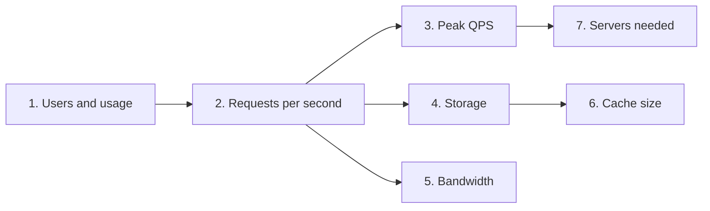

# 1.4 Back-of-the-Envelope Estimation

Goal: quickly turn a vague requirement ("100 million users") into rough numbers (requests per second, storage, bandwidth, servers) that drive design decisions. Precision is not the point. **Being within a factor of 2-10 and showing a clear method is.**

---

## 1. Why interviewers ask for it

The numbers decide the architecture:

| Estimate | Decision it drives |
| --- | --- |
| 40 writes/sec | One database is fine |
| 40,000 writes/sec | Sharding, queues, write-optimised storage |
| 3 TB total data | Fits on one machine |
| 3 PB total data | Distributed storage, partitioning |
| 2 MB/s of traffic | Trivial network |
| 20 Gbps of traffic | CDN, many servers, careful bandwidth planning |
| 35 GB hot data | One cache node holds it all |
| 35 TB hot data | Cache cluster, or rethink what you cache |

If you skip estimation, you may design a sharded, multi-region system for a workload one server could handle, or the opposite.

---

## 2. Numbers to memorise

### 2.1 Units

| Name | Power of 10 | Approx. bytes |
| --- | --- | --- |
| 1 KB | $10^3$ | thousand |
| 1 MB | $10^6$ | million |
| 1 GB | $10^9$ | billion |
| 1 TB | $10^{12}$ | trillion |
| 1 PB | $10^{15}$ | quadrillion |

Counts: thousand ($10^3$), million ($10^6$), billion ($10^9$), trillion ($10^{12}$).

### 2.2 Time

| Period | Seconds | Easy approximation |
| --- | --- | --- |
| 1 minute | 60 | |
| 1 hour | 3,600 | |
| **1 day** | **86,400** | **~$10^5$ (round up to 100,000)** |
| 1 month | ~2.6 million | ~2.5 million |
| 1 year | ~31.5 million | ~$3 \times 10^7$ |

**Handy shortcut:** 1 million requests per day is about **12 requests per second** ($10^6 / 10^5 = 10$, a bit more with the exact 86,400).

### 2.3 Typical sizes of data

| Item | Approx. size |
| --- | --- |
| A character (ASCII) | 1 byte |
| A tweet / short text (140-280 chars) | ~300 bytes |
| A database row (user, URL mapping) | 0.5-1 KB |
| A JSON API response | 1-10 KB |
| A web page (HTML) | ~100 KB |
| A photo (compressed) | 200 KB - 3 MB |
| 1 minute of video (720p-1080p) | ~10-50 MB |
| A 1-hour HD movie | ~1-3 GB |
| An ID | 8 bytes (64-bit) |
| A timestamp | 8 bytes |

### 2.4 Latency numbers

Memorise the orders of magnitude, not the exact values:

| Operation | Time |
| --- | --- |
| Read from memory (RAM) | ~100 nanoseconds |
| Read 1 MB sequentially from RAM | ~10-250 microseconds |
| SSD random read | ~100 microseconds |
| Read 1 MB sequentially from SSD | ~0.2-1 millisecond |
| Round trip within a data centre | ~0.5 ms |
| Disk (HDD) seek | ~10 ms |
| Read 1 MB from HDD | ~5-20 ms |
| Round trip same continent | 30-80 ms |
| Round trip across continents | 100-250 ms |

What they tell you:
- Memory is ~1000x faster than SSD, and SSD ~100x faster than a disk seek. So **cache in memory**.
- A **network round trip inside a data centre is ~0.5 ms**, cross-continent ~150 ms. So **minimise distance and round trips**.
- **Sequential** reads are far faster than random ones.

### 2.5 Throughput rules of thumb (one machine)

Rough, depends heavily on the workload. Use them as starting points and say so.

| Component | Approx. capacity per machine |
| --- | --- |
| App server (simple request) | 1,000-10,000 requests/sec (depends on work per request) |
| Relational DB, simple indexed reads | ~5,000-10,000 queries/sec (single node) |
| Relational DB, writes | ~1,000-5,000 writes/sec (single node) |
| Redis / Memcached | ~50,000-100,000+ ops/sec |
| Kafka (one broker) | hundreds of thousands of messages/sec |
| Network card | 1-10 Gbps (125 MB/s to 1.25 GB/s) |
| Single machine storage | a few TB to tens of TB |
| Single machine RAM | 64 GB to a few hundred GB |

---

## 3. The estimation method

### Step 1: Pin down the inputs (ask the interviewer, or state assumptions)
- Total users and **DAU** (daily active users).
- Actions per user per day (reads and writes).
- **Read:write ratio.**
- Size of one record or object.
- How long data is kept.

State assumptions out loud. Interviewers care about the reasoning.

### Step 2: Requests per second (QPS)

$$\text{QPS} = \frac{\text{requests per day}}{86{,}400} \approx \frac{\text{requests per day}}{10^5}$$

### Step 3: Peak QPS
Traffic isn't flat. Use a multiplier of **2x to 5x** the average, depending on the product (a flash sale is 10x or more).

$$\text{Peak QPS} \approx 2\text{ to }5 \times \text{average QPS}$$

Design for peak, not the average.

### Step 4: Storage

$$\text{Storage} = \text{new items per day} \times \text{size per item} \times \text{retention (days)}$$

Add a multiplier for replication (usually 3x) and indexes/overhead (often 1.2-2x) if relevant.

### Step 5: Bandwidth

$$\text{Bandwidth} = \text{QPS} \times \text{size per request/response}$$

Convert carefully: 1 byte = 8 bits, and network speeds are quoted in **bits** (Gbps), storage in **bytes**.

### Step 6: Cache size
Typical access follows the **80/20 rule**: ~20% of the data gets ~80% of the reads. Cache the hot 20% of a day's data:

$$\text{Cache size} \approx 0.2 \times \text{daily read data volume}$$

### Step 7: Servers

$$\text{Servers} = \frac{\text{Peak QPS}}{\text{QPS per server}}$$

Add headroom (run at ~50-70% utilisation) and extra servers for redundancy (at least 2, in different zones).

---

## 4. Worked example A: URL shortener

**Assumptions (state them out loud):**
- 100 million new URLs per month.
- Read:write ratio = **100:1** (people click links far more than they create them).
- Each record is ~500 bytes (short code, long URL, metadata).
- Keep data for 5 years.

### Writes per second
$$\frac{100\text{M}}{30 \text{ days} \times 86{,}400} = \frac{10^8}{2.6 \times 10^6} \approx 40 \text{ writes/sec}$$

### Reads per second
$$40 \times 100 = 4{,}000 \text{ reads/sec}$$

### Peak
$$4{,}000 \times 3 \approx 12{,}000 \text{ reads/sec}$$

### Storage
- Per month: $10^8 \times 500\text{ B} = 5 \times 10^{10}\text{ B} = 50$ GB.
- Over 5 years (60 months): $60 \times 50\text{ GB} = 3{,}000\text{ GB} = $ **3 TB**.
- With 3x replication: ~9 TB.

### Bandwidth
- Reads: $4{,}000 \times 500\text{ B} = 2$ MB/s, trivial.

### Cache
- Reads per day: $4{,}000 \times 86{,}400 \approx 345$ million.
- Data: $345\text{M} \times 500\text{ B} \approx 170$ GB per day.
- Cache the hot 20%: **~35 GB**, which fits in one Redis machine.

### What the numbers tell us
| Finding | Design implication |
| --- | --- |
| 40 writes/sec | A single database easily handles writes |
| 12,000 reads/sec at peak | Too much for one DB node, so a cache (and/or read replicas) is justified |
| 3 TB over 5 years | A single node could store it, but shard or partition for headroom and availability |
| 35 GB hot data | One cache node is enough (add a replica for availability) |
| 2 MB/s | Network isn't a concern |

**Conclusion:** it's a read-heavy, small system. Cache plus a database with replicas is plenty. You've avoided over-engineering by using numbers.

---

## 5. Worked example B: photo sharing app

**Assumptions:**
- 10 million DAU, each uploads **2 photos/day**, each photo **2 MB**.
- Each user views 50 photos/day, each served as ~200 KB (a thumbnail or compressed version).

### Upload rate
- Photos per day: $10\text{M} \times 2 = 20\text{M}$.
- Uploads/sec: $20\text{M} / 86{,}400 \approx 230$ uploads/sec. Peak (3x): ~700/sec.

### Storage
- Per day: $20\text{M} \times 2\text{ MB} = 40\text{ TB/day}$.
- Per year: $40 \times 365 \approx 14.6\text{ PB}$ (about **15 PB per year**). With 3x replication, ~45 PB.

### Upload bandwidth
- $230 \times 2\text{ MB} = 460\text{ MB/s} \approx 3.7\text{ Gbps}$ average.

### Download bandwidth
- Views per day: $10\text{M} \times 50 = 500\text{M}$. Per second: $500\text{M}/86{,}400 \approx 5{,}800$ views/sec.
- $5{,}800 \times 200\text{ KB} \approx 1.2\text{ GB/s} \approx 9.3\text{ Gbps}$ average, more at peak.

### What the numbers tell us
| Finding | Design implication |
| --- | --- |
| 15 PB per year | Can't be a normal database: use **object storage (S3-style)** for photos, a DB only for metadata |
| ~10 Gbps outbound | Serve through a **CDN**, otherwise the origin is overwhelmed |
| 230 uploads/sec | Manageable by a modest cluster, but uploads are large, so use direct-to-storage uploads (pre-signed URLs) |

---

## 6. Shortcuts that save time

- **Round aggressively.** 86,400 is 100,000. 2.6 million is 2.5 million. 365 is 400 (or 300). Keep one or two significant digits.
- **Work in powers of 10.** $10^8 / 10^5 = 10^3$.
- **Convert early:** requests per day to per second, then think per second.
- **Think in orders of magnitude.** The question is "10 or 10,000?", not "42 or 47?".
- **Use the 1M requests/day = 12/sec shortcut.** 100M/day is ~1,200/sec, 1B/day is ~12,000/sec.
- **Write units on every line.** Most mistakes are unit mix-ups (bits vs. bytes, KB vs. MB).

---

## 7. Common mistakes

- Using the **average** and forgetting **peak**.
- Mixing **bits and bytes** (Gbps vs. GB/s: a factor of 8).
- Forgetting **replication** (3x) in storage.
- Forgetting the **read:write ratio**, and treating all requests alike.
- Using **total users** instead of **DAU** for traffic.
- Doing exact arithmetic slowly instead of rounding.
- Not stating assumptions, or not connecting the result to a design decision. **Always end with "so this means..."**
- Estimating, then designing something unrelated to the numbers.

---

## 8. Interview questions

**Q1. How many servers do you need for 10,000 QPS?**
Ask what each request does. Assume a simple request handled by one server at about 1,000 QPS, with headroom at ~50-70% utilisation. That's about 10 servers at full load, so ~15-20 with headroom, and at least 2 per availability zone for redundancy. Mention that caching can reduce it.

**Q2. 100 million DAU, each making 10 requests/day. What's the QPS?**
$100\text{M} \times 10 = 10^9$ requests/day. $10^9 / 10^5 = 10{,}000$ QPS on average. Peak at 3x: ~30,000 QPS.

**Q3. Estimate storage for a messaging app with 500 million users sending 40 messages/day, 100 bytes each, kept 5 years.**
Messages/day: $500\text{M} \times 40 = 2 \times 10^{10}$. Bytes/day: $2 \times 10^{10} \times 100 = 2 \times 10^{12} = 2$ TB/day. Over 5 years (~1,800 days): ~3.6 PB. With 3x replication: ~11 PB. (Not every user is active daily, so adjust if you're told DAU.)

**Q4. How do you estimate cache size?**
Take the daily read data volume and cache the hot ~20% (80/20 rule). Check it fits in memory on one node or a small cluster, then verify the hit ratio assumption.

**Q5. What does 99.99% availability allow?**
Downtime per year is $0.0001 \times 525{,}600$ min $\approx 52$ minutes, or ~4.4 minutes per month. (More in 1.5.)

**Q6. Why is estimation important in an interview?**
It turns vague requirements into constraints, so you pick a proportionate design: no sharding for 40 writes/sec, and a CDN and object storage when you hit petabytes and gigabits.

**Q7. [Senior] The estimate says a single Postgres node handles the load, but the interviewer pushes for sharding. How do you respond?**
Show the numbers: QPS, storage and growth are within one node (plus replicas). Explain you'd start simple and name what would force sharding: write throughput beyond a single leader, dataset beyond one machine's disk, or availability and latency needs. Design the shard key so migration is possible later. This demonstrates trade-off thinking, not over-engineering.

---

## 9. One-page summary

| Item | Formula or number |
| --- | --- |
| Seconds per day | 86,400, round to $10^5$ |
| 1M requests/day | ~12 requests/sec |
| QPS | requests per day / $10^5$ |
| Peak QPS | 2-5x average |
| Storage | items/day x size x retention x replication (3x) |
| Bandwidth | QPS x size per request (watch bits vs. bytes) |
| Cache | ~20% of the daily read data (80/20 rule) |
| Servers | peak QPS / QPS per server, plus headroom and redundancy |
| RAM vs SSD vs HDD seek | 100 ns vs. 100 µs vs. 10 ms |
| Round trip | 0.5 ms in a data centre, 30-80 ms same continent, 100-250 ms across oceans |
| Method | Inputs, QPS, peak, storage, bandwidth, cache, servers, then "so this means..." |
