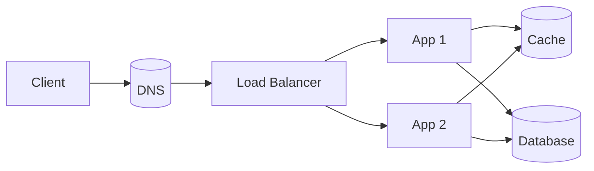

# 1.5 Availability & Reliability

Goal: understand what "99.99% available" means, how it's measured (SLI, SLO, SLA), how to calculate it for a system, and how to remove single points of failure.

---

## 1. Two words that are not the same

| | Meaning | Question it answers |
| --- | --- | --- |
| **Availability** | The fraction of time the system is **up and able to serve requests** | "Can I use it right now?" |
| **Reliability** | The probability the system **works correctly** without failing over a period of time | "Does it keep working and give right answers?" |

Example: a service that crashes every hour but restarts in 1 second is **highly available** (up 99.97% of the time) but **not very reliable** (it fails often, and in-flight requests are lost).

In interviews the two are used loosely together. Availability is the one you quantify.

---

## 2. The "nines"

Availability is quoted as a percentage with "nines".

$$\text{Availability} = \frac{\text{uptime}}{\text{uptime} + \text{downtime}}$$

| Availability | Name | Downtime per year | Per month (30 days) | Per day |
| --- | --- | --- | --- | --- |
| 99% | two nines | 3.65 days | 7.2 hours | 14.4 min |
| 99.9% | three nines | 8.76 hours | 43.2 min | 1.44 min |
| 99.99% | four nines | 52.6 min | 4.3 min | 8.6 sec |
| 99.999% | five nines | 5.26 min | 26 sec | 0.86 sec |
| 99.9999% | six nines | 31.5 sec | 2.6 sec | 0.09 sec |

**How to compute it fast:** downtime = $(1 - \text{availability}) \times$ time period.
For 99.9% over a year: $0.001 \times 525{,}600 \text{ min} \approx 525$ min $\approx 8.76$ hours.

### Each extra nine is much harder
Going from 99.9% to 99.99% means cutting allowed downtime from 43 to 4 minutes a month. At that scale a human can't react in time. You need **automatic** failover, redundancy at every layer, safe deployments, and heavy monitoring. Each extra nine often costs 10x more. So pick the target from the **business need**:

| Type of system | Typical target |
| --- | --- |
| Internal tool, batch job | 99% - 99.9% |
| Normal consumer website / API | 99.9% - 99.99% |
| Payments, core cloud services | 99.99% - 99.999% |

Ask the interviewer: "what availability do we need?" A system that needs 99.9% doesn't need a multi-region active-active design.

---

## 3. SLI, SLO, SLA

Three layers that are often confused:

| Term | Stands for | What it is | Example |
| --- | --- | --- | --- |
| **SLI** | Service Level **Indicator** | A **measurement** of how the service is doing | "Percentage of requests that return success (non-5xx)", "p99 latency" |
| **SLO** | Service Level **Objective** | An internal **target** for an SLI | "99.9% of requests succeed over 30 days", "p99 latency < 300 ms" |
| **SLA** | Service Level **Agreement** | A **contract** with customers, with consequences if broken | "99.9% monthly uptime, otherwise 10% service credit" |

```
SLI (what we measure)  ->  SLO (what we aim for)  ->  SLA (what we promise, with penalties)
```

- The **SLO is usually stricter than the SLA**, to leave a safety margin. If the SLA promises 99.9%, you aim internally for 99.95%.
- Good SLIs measure what **users experience** (successful requests, latency), not server health (CPU).

### Error budget
If the SLO is 99.9% over 30 days, you may fail 0.1% of the time:

$$\text{Error budget} = (1 - 0.999) \times 30 \times 24 \times 60 = 43.2 \text{ minutes}$$

- Budget left: ship new features, take risks.
- Budget used up: freeze risky releases and spend time on reliability.

This turns "be reliable" into a number that teams can manage.

---

## 4. Calculating availability of a whole system

### 4.1 Components in series (all must work)
If a request needs component A **and** B **and** C, the availability multiplies:

$$A_{\text{total}} = A_1 \times A_2 \times A_3$$

Example: load balancer, app server and database, each 99.9%:

$$0.999 \times 0.999 \times 0.999 \approx 0.997 = 99.7\%$$

**Lesson:** a chain is less available than its weakest link. More dependencies in the request path means lower availability. Ten services at 99.9% each give ~99.0%.

### 4.2 Components in parallel (redundancy: any one is enough)
If you have $n$ independent copies and the system works if **at least one** works:

$$A_{\text{total}} = 1 - (1 - A)^n$$

Example: two servers, each 99% available:

$$1 - (0.01)^2 = 1 - 0.0001 = 99.99\%$$

Redundancy raises availability a lot: two 99% servers behave like one 99.99% system.

### 4.3 Putting it together
```
Client -> [LB 99.99%] -> [2 app servers, each 99%] -> [DB 99.9%]

Servers in parallel:  1 - 0.01^2           = 99.99%
Whole chain:          0.9999 x 0.9999 x 0.999 = 99.88%
```
The weakest part is now the **database**, so that's where to add redundancy next (replica with automatic failover).

**Caveats:** the formula assumes failures are **independent**. Servers in the same rack, zone, or sharing the same bug can fail together. That's why you spread across availability zones and avoid shared dependencies.

### 4.4 MTBF and MTTR
$$\text{Availability} = \frac{\text{MTBF}}{\text{MTBF} + \text{MTTR}}$$

- **MTBF** = Mean Time Between Failures (how often it breaks).
- **MTTR** = Mean Time To Repair/Recover (how fast you fix it).

Example: breaks every 1,000 hours, takes 1 hour to recover: $1000 / 1001 \approx 99.9\%$.

Two ways to improve: **fail less** (raise MTBF) or **recover faster** (cut MTTR). In practice, cutting MTTR with automatic failover and fast rollback is cheaper and more effective than preventing every failure.

---

## 5. Single points of failure (SPOF)

A **SPOF** is any component whose failure takes down the whole system. Finding and removing them is the core availability exercise.

### How to find SPOFs
Walk the request path from 1.1 and ask of every box: "If this dies, what happens?"



| Component | Is it a SPOF? | Fix |
| --- | --- | --- |
| DNS | Yes, if one provider | Two DNS providers |
| Load balancer | Yes, if one | Two or more LBs across zones, or a managed LB |
| App servers | No (2+) | Make sure they are in different zones |
| Cache | Yes, if one node | Replicas, and make sure the system survives a cold cache |
| Database | Yes, if one | Primary plus replica with automatic failover |
| The data centre / zone | Yes | Spread across multiple availability zones |
| The region | Yes | Multi-region (only if the requirement justifies the cost) |
| Shared dependency (auth service, config store) | Often forgotten | Redundancy, caching, graceful degradation |
| People | "Only one person knows how to deploy" | Runbooks, automation |

---

## 6. How to get redundancy

### 6.1 Active-active
All copies **serve traffic at the same time**. A load balancer spreads requests across them.

```
        +--> Server A (serving)
LB ---->|
        +--> Server B (serving)
```
- If one dies, the others absorb its load, with no failover delay.
- Efficient: all capacity is in use. But the remaining servers must handle the extra load (**N+1** capacity planning).
- Easy for stateless services (app servers). Harder for data, because both copies accept writes and can conflict.

### 6.2 Active-passive (failover)
One copy serves traffic (**active**), another waits (**passive/standby**) and takes over if the active one fails.

```
Clients ---> Primary (active) ----replicates----> Standby (passive)
                  X dies
Clients ---> Standby promoted to primary
```

| Standby type | State | Failover time |
| --- | --- | --- |
| **Hot** | Running and fully in sync | Seconds |
| **Warm** | Running, slightly behind or scaled down | Minutes |
| **Cold** | Not running, needs to be started and restored | Hours |

- Simpler for data (one writer), but the standby capacity sits idle.
- Needs reliable **failure detection** and a correct **promotion** process.

### 6.3 Failure detection and failover
- **Health checks / heartbeats:** the monitor pings each node every few seconds. After N missed checks the node is marked dead.
- **Trade-off:** too sensitive means false alarms (a slow node gets declared dead and traffic flaps). Too relaxed means slow detection and longer downtime.
- **Split brain:** if the standby can't reach the primary because of a network problem (not a crash), both may think they are the primary and accept conflicting writes. Prevent it with a quorum or a third-party witness and with fencing. This leads to consensus (3.9).

### 6.4 Where redundancy applies
| Layer | Technique |
| --- | --- |
| Compute | Multiple instances behind a load balancer, autoscaling, spread across zones |
| Data | Replication (leader-follower, multi-leader), backups |
| Network | Multiple LBs, redundant links, multi-AZ |
| Location | Multi-AZ (survive a data centre failure), multi-region (survive a region failure) |

---

## 7. Beyond redundancy: keeping the system up

- **Graceful degradation:** if a non-critical part fails, keep the core working. Example: recommendations are down, but the product page still loads with a default list.
- **Timeouts and retries with backoff:** don't hang forever on a slow dependency, and don't retry in a flood (see 4.6).
- **Circuit breakers:** stop calling a failing service for a while, so it isn't overwhelmed and you fail fast.
- **Rate limiting and load shedding:** under overload, reject some requests to keep serving the rest.
- **Safe deployments:** most outages come from **changes**. Use canary releases, gradual rollouts, feature flags, and **fast rollback**.
- **Monitoring and alerting:** you can't fix what you can't see. Alert on user-facing SLIs.
- **Backups and disaster recovery:** tested restores. A backup you never restored is not a backup (see 5.5 for RPO and RTO).
- **Chaos testing:** deliberately kill components in production-like environments to check the system really survives.

---

## 8. Availability vs. consistency (a preview of Phase 3)

Strong redundancy across a network creates a trade-off. During a network partition, a system must either:
- keep **serving** and risk inconsistent data (favour availability), or
- **refuse** some requests to stay consistent (favour consistency).

This is the CAP theorem (see 3.8). For now: **higher availability sometimes costs consistency**, and you should decide which matters for each piece of data (a social feed can be stale, a bank balance cannot).

---

## 9. Common pitfalls

- Aiming for "as many nines as possible" without a business reason or cost estimate.
- Forgetting that **dependencies multiply**: a request that touches 10 services is only as available as the product of all.
- Adding redundancy but leaving a **hidden SPOF** (a single load balancer, one DNS provider, one config service, one shared database).
- Assuming failures are independent when replicas share a zone, a rack, a deployment, or a bug.
- Redundancy that is **never tested**: the failover has never run and fails when needed.
- Ignoring **deployments and config changes**, the most common cause of outages.
- Measuring server uptime instead of what users experience (a server can be "up" and returning errors).
- Treating the SLA as the target, instead of keeping an SLO stricter than the SLA.

---

## 10. Interview questions with model answers

**Q1. What does 99.99% availability allow per month?**
$0.0001 \times 43{,}200$ min $\approx 4.3$ minutes per month, or about 52 minutes per year.

**Q2. What's the difference between SLI, SLO and SLA?**
SLI is the measurement (e.g. the percentage of successful requests). SLO is the internal target for it (99.9%). SLA is the contractual promise to customers, with penalties such as credits. The SLO is set stricter than the SLA so you have a margin.

**Q3. How do you calculate the availability of a system with several components?**
In series, multiply availabilities. In parallel (redundant copies), $1 - (1-A)^n$. For example, two 99% servers in parallel give 99.99%, but a chain of LB, servers and DB is limited by its weakest component.

**Q4. Where are the single points of failure in a typical web architecture, and how do you remove them?**
DNS (use two providers), the load balancer (redundant LBs across zones), the database (primary plus replica with automatic failover), the cache (replicas and tolerate cold cache), the availability zone (spread across zones), and shared dependencies such as auth or config services. App servers are redundant if stateless and spread across zones.

**Q5. Active-active vs. active-passive?**
Active-active: all nodes serve traffic at once, which uses capacity efficiently and has no failover delay, but needs N+1 headroom and is harder for writes to data. Active-passive: a standby takes over on failure, which is simpler for data consistency but wastes idle capacity and has a failover delay (hot: seconds, cold: hours).

**Q6. What's an error budget?**
The allowed unreliability under the SLO, for example 0.1% (43 minutes a month) for a 99.9% SLO. While budget remains, teams can ship risky changes. When it's spent, they pause releases and fix reliability.

**Q7. How do you improve availability: reduce failures or speed up recovery?**
Both, but recovery is usually cheaper. Availability = MTBF/(MTBF + MTTR), and cutting MTTR with automatic failover, health checks, and fast rollback often beats trying to prevent every failure.

**Q8. Your service calls 5 downstream services, each 99.9% available. What's your best-case availability?**
$0.999^5 \approx 99.5\%$. To do better, remove dependencies from the critical path, add caching and fallbacks, make non-critical calls degrade gracefully, or add redundancy to the weakest ones.

**Q9. How would you handle a database primary failure?**
Health checks detect it, a replica is promoted automatically (with fencing to avoid split brain), the app reconnects through a stable endpoint or proxy, and writes in flight at the moment of failure may need to be retried (so make writes idempotent). Accept brief unavailability for writes, while reads continue from replicas.

**Q10. [Senior] When is multi-region worth it?**
When the availability or latency target can't be met with multi-AZ in one region (region-level outages), or for compliance and global latency. The costs are higher complexity, data replication and consistency challenges, and double the infrastructure, so it should be justified by a stated SLO rather than used by default.

---

## 11. One-page summary

| Concept | Remember |
| --- | --- |
| **Availability** | uptime / total time. Quoted in nines |
| **Nines** | 99.9% = 43 min/month, 99.99% = 4.3 min/month, 99.999% = 26 s/month |
| **Each nine costs more** | Pick the target from business need, not ambition |
| **SLI / SLO / SLA** | Measurement / internal target / contract with penalties. SLO stricter than SLA |
| **Error budget** | $1 - \text{SLO}$: the allowed downtime to spend on change |
| **Series** | Multiply availabilities: more dependencies means lower availability |
| **Parallel** | $1-(1-A)^n$: redundancy raises availability sharply |
| **MTBF / MTTR** | MTBF/(MTBF+MTTR). Faster recovery is often the cheapest win |
| **SPOF** | Walk the request path, ask "what if this dies?", add redundancy |
| **Active-active vs. passive** | All serve vs. standby takes over |
| **Beyond redundancy** | Degrade gracefully, timeouts, circuit breakers, safe deploys, tested backups |
| **Watch out for** | Hidden SPOFs, correlated failures, untested failover, risky deployments |
