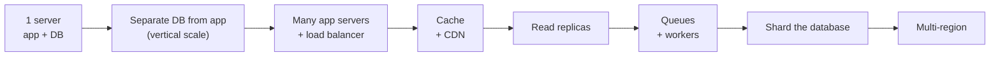

# 1.6 Scalability

Goal: understand what "scale" means, the difference between scaling **up** and scaling **out**, why stateless services are the key, and the usual path for scaling each layer (app, cache, database).

---

## 1. What is scalability?

A system is **scalable** if it can handle **more load by adding resources**, without a redesign and without performance falling apart.

"Load" can be:
- more users or requests per second,
- more data stored,
- more data per request (bigger files, larger payloads),
- more geography (users in more regions).

### Scalability vs. performance

| | Performance | Scalability |
| --- | --- | --- |
| Question | How fast is it for **one** request? | Does it **stay fast as load grows**? |
| Example | A page loads in 100 ms | Still 100 ms with 1 million users, by adding servers |
| Fix | Optimise code, add an index | Add machines, split data, add caches |

A system can be fast but not scalable (one very fast server that maxes out at 5,000 QPS), or scalable but not fast (a distributed system with high latency per request).

### What the goal looks like
```
Load:        1x   ->   10x   ->   100x
Servers:     1         10         100        (cost grows roughly in line with load)
Latency:     same      same       same
```
Doubling the machines should come close to doubling capacity.

---

## 2. Vertical scaling (scale up)

Make **one machine bigger**: more CPU, more RAM, faster disks.

```
Before:  [ 4 CPU, 16 GB RAM ]
After:   [ 64 CPU, 512 GB RAM ]
```

| Pros | Cons |
| --- | --- |
| Simple: no code changes, no distribution | **Hard ceiling**: the biggest machine you can buy |
| No network hops between parts, strong consistency is easy | **Price grows faster than capacity** (a machine twice as big costs more than twice as much) |
| Good for early stage and for databases | **Single point of failure**: one machine down means everything down |
| | Upgrading often means **downtime** (restart) |

---

## 3. Horizontal scaling (scale out)

Add **more machines** and share the work between them.

```
Before:  [Server]
After:   [Server] [Server] [Server] [Server] ... behind a load balancer
```

| Pros | Cons |
| --- | --- |
| **No practical ceiling**: keep adding machines | More complex: load balancing, data distribution, consistency |
| Uses **cheap commodity** machines | Network calls replace in-process calls (slower, can fail) |
| **Built-in redundancy**: one machine failing is not an outage | Harder debugging, deployment and monitoring |
| Scale up and down with demand (autoscaling) | Needs the application to be designed for it (stateless, see below) |

### Which to choose?
| Situation | Typical choice |
| --- | --- |
| Early stage, modest load | Vertical first (simplest) |
| Stateless web/app tier | Horizontal (easy) |
| Relational database | Vertical first, then read replicas, then sharding |
| Large scale / high availability | Horizontal everywhere possible |

In practice you **do both**: use reasonably sized machines, and add more of them.

---

## 4. The key to horizontal scaling: stateless services

(Recall 1.1.) A **stateless** server keeps nothing about a user between requests. Any request can go to any server.

```
Stateful (breaks scaling):
  Request 1 -> Server A  (login stored in A's memory)
  Request 2 -> Server B  (doesn't know the user: "please log in again")

Stateless (scales):
  Request 1 -> Server A  -> state in shared store (Redis / DB / token)
  Request 2 -> Server B  -> reads the same shared store, works
```

How to make a service stateless:
- Session data goes to a **shared store** (Redis), or into a **signed token** (JWT) sent by the client.
- Uploaded files go to **object storage**, not the server's local disk.
- No in-memory data that must survive between requests (use caches only as an optimisation, never as the only copy).
- Background jobs go to a **queue**, not to a thread on one server.

Result: add or remove servers any time and the load balancer spreads the traffic.

**Where does the state go?** It doesn't disappear. It moves to **specialised stateful systems** (database, cache, queue, object storage), and those are the ones that are hard to scale. That's why most of the rest of the course (Phases 2 and 3) is about scaling state.

---

## 5. Scaling each layer

### 5.1 Web / app tier: easy
Stateless, so just add more servers behind a load balancer.

```
LB ---> App 1
   ---> App 2
   ---> App 3   (add more as load grows, autoscale on CPU or request rate)
```

**Autoscaling:** the cloud adds servers when load rises (e.g. CPU > 60%) and removes them when it drops, so you pay for what you use. Warm-up time matters: new servers need seconds to minutes to be ready, so scale **before** the peak when you can predict it.

### 5.2 Reads: cache first, then replicas
Most systems are read-heavy. Reduce database reads in this order:

1. **Client / CDN caching** for static or public content (zero load on your servers).
2. **Application cache** (Redis) for hot data, cache-aside. Often removes 80-95% of DB reads.
3. **Read replicas**: copies of the database that serve reads. Writes still go to one primary.

```
App ---> Cache (hit: done)
   ---> miss ---> Read replicas (many)
Writes ---------> Primary
```
Cost: replicas can lag behind the primary (stale reads), see Phase 3.

### 5.3 Writes and large data: partitioning (sharding)
When one database machine can't hold all the data or handle all the writes, **split the data** across machines. Each machine (shard) holds a part:

```
user_id 1-1M   -> Shard 1
user_id 1M-2M  -> Shard 2
user_id 2M-3M  -> Shard 3
```
Writes and storage now scale with the number of shards. Costs: cross-shard queries and transactions are hard, **hot shards** if load is uneven, **resharding** is painful. Choosing a good **shard key** is the central design decision (see 3.5).

### 5.4 Heavy or slow work: queues and workers
Don't do slow work inside the request. Put it on a **queue** and let a separate pool of **workers** handle it. Scale the workers independently of the web tier.

```
App ---> Queue ---> Workers (1, 2, 3 ... add more when the queue grows)
```
Queues also **absorb spikes**: a sudden burst waits in the queue instead of overloading the system.

### 5.5 Static content and global users: CDN and regions
- CDN serves static files from the edge, removing most bandwidth from your origin.
- Multiple regions bring servers closer to users and spread load (at the cost of data replication complexity).

### 5.6 Typical scaling path

Start simple and move right only when the numbers (from 1.4) demand it. Each step adds complexity.

---

## 6. Finding the bottleneck

Scaling something that isn't the bottleneck changes nothing. The slowest, most limited resource caps the whole system:

```
Request path capacity:
  Load balancer: 100k QPS
  App tier (10 servers): 20k QPS
  Database (1 primary): 3k QPS   <-- the bottleneck: the system maxes out at 3k QPS
```
Adding 50 more app servers does nothing. Fix the database first.

### Process
1. **Measure**: metrics for CPU, memory, disk, network, queue length, latency percentiles, error rate per component.
2. Find the component that is **saturated first** (highest utilisation, growing queue, rising latency).
3. **Fix that one** (cache, replica, shard, bigger machine).
4. Repeat: the bottleneck moves to the next component.

### Usual suspects
| Component | Typical bottleneck |
| --- | --- |
| App server | CPU, memory, number of connections or threads |
| Database | Writes, slow queries (missing index), connection limit, disk I/O |
| Cache | Memory size, a single hot key |
| Network | Bandwidth, cross-region latency |
| Downstream service | Its own capacity, so your threads pile up waiting |
| Queue | Slow consumers, big backlog |

---

## 7. Limits to scaling

### 7.1 Shared state and coordination
Anything that every request must touch becomes the ceiling: a single database primary, a single lock, a global counter, a leader node. Adding servers doesn't help if they all wait on the same thing.

Techniques: **partition** the shared thing (shard), **avoid** the shared thing (design out the global counter, use approximations), **batch** updates, **make it asynchronous**.

### 7.2 Hot spots
Uneven load, such as one celebrity user or one popular product, overloads one shard or cache node while others sit idle. Fixes: better shard keys, caching the hot item, splitting hot keys, replicating hot data.

### 7.3 Diminishing returns (Amdahl's law)
If part of the work must be done serially (e.g. 10% can't be parallelised), the maximum speedup is $1/0.10 = 10\times$, no matter how many machines you add. The serial part becomes the bottleneck.

### 7.4 Cost
Linear growth in machines means linear growth in cost. Efficiency matters: a 2x cheaper query is worth as much as doubling the fleet.

---

## 8. Design principles for scalable systems

- **Stateless services**, state in dedicated stores.
- **Cache aggressively** (client, CDN, app, DB).
- **Asynchronous processing** with queues for anything that can wait.
- **Partition data** along the access pattern; avoid cross-partition operations.
- **Avoid single shared resources**: no global locks or counters.
- **Replicate** for read scale and availability.
- **Loose coupling**: services scale independently (see microservices, 4.5).
- **Design for failure**: at scale, machines fail every day (see 1.5).
- **Measure first**: scale based on numbers, not guesses (see 1.4).
- **Keep it simple until the load requires more.** Don't shard 10 GB of data.

---

## 9. Worked example: scaling a growing service

Starting point: one server running app and database, handling 100 QPS.

| Stage | Load | Problem | Change |
| --- | --- | --- | --- |
| 1 | 100 QPS | None | Single server |
| 2 | 1,000 QPS | App and DB compete for CPU and RAM | Separate the DB onto its own machine, upgrade both (vertical) |
| 3 | 5,000 QPS | App server is saturated, and it's a SPOF | Several stateless app servers behind a load balancer |
| 4 | 20,000 QPS | DB reads are the bottleneck (reads are 95% of traffic) | Add Redis cache and read replicas, CDN for static files |
| 5 | 50,000 QPS, slow tasks | Emails and image processing slow requests | Queue and worker pool |
| 6 | Writes at 10,000/s, 20 TB data | Single primary can't keep up | Shard the database |
| 7 | Global users | High latency far from the data centre | Multi-region, GeoDNS and CDN |

At each step the **bottleneck** drove the change, and the change added only as much complexity as needed.

---

## 10. Common pitfalls

- **Premature scaling:** sharding and microservices for a workload one machine handles. Complexity has a cost.
- **Scaling the wrong thing:** adding app servers when the database is the bottleneck.
- **Stateful servers** (sessions in memory, files on local disk) blocking horizontal scaling.
- **A hidden single bottleneck**: one DB primary, one lock, one queue partition, one cache node for hot keys.
- **Ignoring data scaling:** the app tier is easy, while data is where the real difficulty lies.
- **Ignoring hot keys** and assuming even load.
- **No autoscaling or capacity plan** for predictable peaks (sales, events).
- **Forgetting the cost** side and the operational burden of many machines.
- **Not load testing:** you don't know where it breaks until you push it.

---

## 11. Interview questions with model answers

**Q1. Vertical vs. horizontal scaling?**
Vertical adds resources to one machine: simple, but there's a hard ceiling, rising cost, and it's a single point of failure. Horizontal adds more machines: nearly unlimited, cheaper and redundant, but needs a stateless design, load balancing and data distribution. Start vertical for simplicity, go horizontal as needed, and use both in practice.

**Q2. Why must services be stateless to scale horizontally?**
If state lives in one server's memory, requests have to return to that server, which creates uneven load and loses state on failure. Stateless servers let the load balancer send any request anywhere, so you can add or remove servers freely. State moves to a shared store (Redis, DB, tokens).

**Q3. How would you scale a read-heavy system?**
CDN for static content, an application cache (Redis) for hot data, then read replicas for the remainder. Possibly precompute or denormalise results.

**Q4. How would you scale a write-heavy system?**
Partition (shard) the data so writes spread across nodes, use write-optimised stores (LSM-tree based), batch writes, and put a queue in front to absorb spikes and smooth the load. Pick a shard key that avoids hot spots.

**Q5. How do you decide what to scale?**
Measure to find the bottleneck, the component that saturates first, and fix that one. Use the estimates from 1.4 to see where the numbers exceed a single node's capacity.

**Q6. What's a hot spot, and how do you handle it?**
Uneven load on one shard, key or node (a celebrity, a viral product). Mitigate with caching the hot item, splitting the key (e.g. adding a suffix), replicating the hot data, or choosing a better partitioning scheme.

**Q7. Scalability vs. performance vs. availability?**
Performance is speed for one request, scalability is keeping performance as load grows, availability is staying up despite failures. Horizontal scaling usually improves both scalability and availability, because redundancy comes with it.

**Q8. Your service handles 5,000 QPS today and needs 100,000 in a year. What do you do?**
Estimate with 1.4 (peak, read/write split, storage). Make the app tier stateless and autoscaled, add caching and CDN to cut load per request, add read replicas, move slow work to queues, and plan the sharding strategy for the data. Load test to find the first bottleneck and fix it, rather than rebuilding everything at once.

**Q9. [Senior] What are the limits of horizontal scaling?**
Shared state and coordination (locks, leaders, global counters), serial portions of work (Amdahl's law), hot keys, network overhead and tail latency across many machines, operational complexity and cost, and consistency trade-offs when data is distributed.

**Q10. [Senior] How do you scale a stateful system such as a database?**
Vertical first, then replicas for reads, then partition the data on a well-chosen key, with replication per partition for availability. Handle rebalancing (consistent hashing, see 2.10), cross-shard queries and transactions, and hot partitions.

---

## 12. One-page summary

| Concept | Remember |
| --- | --- |
| **Scalability** | Handle more load by adding resources, keeping performance |
| **Vertical** | Bigger machine: simple, but ceiling, cost, SPOF |
| **Horizontal** | More machines: no ceiling, redundant, but more complex |
| **Stateless** | Key to scaling the app tier. State goes to Redis, DB, tokens, object storage |
| **Reads** | CDN, then cache, then read replicas |
| **Writes / data** | Partition (shard) with a good key; queues for spikes |
| **Slow work** | Queue and workers, scaled separately |
| **Bottleneck** | Measure, fix the saturated component, repeat |
| **Limits** | Shared state, hot spots, serial work (Amdahl), cost |
| **Principle** | Start simple, scale where the numbers say so |
